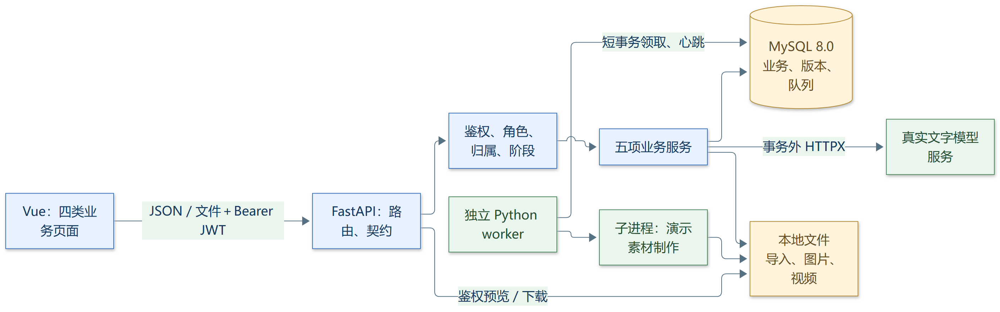

# 电商运营助手后端开发流程文档

版本：1.0。日期：2026-09-28。用途：按顺序实现、联调并演示学校教学项目。

**当前交付为开发流程、契约补充和 12 份流程图源；图片导出尚未齐全，见第 13 节。后端代码、数据库迁移、服务启动和课堂软件验收均未执行。** 文中的目录、函数名、命令和伪代码是实施约定，不代表工作区已经存在对应程序。

## 1. 阅读入口、范围及开发顺序

| 依据 | 使用方式 |
| --- | --- |
| [原始需求](../Damend/Damend) | 开发范围、四类页面、五项后端职责、生成结构、五部分报告和 A1—A8 验收。 |
| [项目规则](../AGENTS.md) | 已确认的真实／模拟边界、角色权限、商品归属、任务、导入及指标规则。 |
| [总体规格](../SPEC.md) | 已确认架构、对象、业务流程、接口及唯一一套七天演示原始数据。 |
| [后端需求](后端需求文档.md) | 字段、72 个方法与路径、请求响应、状态码、版本、模板及异常规则。 |
| [前端需求](前端需求文档.md) | 页面所需数据、恢复工作台、轮询、工作表选择、全部导入明细和审批交互。 |
| [前端开发流程](前端开发流程文档.md) | F0—F8 对接本文 P1—P7，72 个方法路径、全部界面、部分保存恢复与联合验收；不改变本项目业务边界。 |
| [业务术语](../Damend/CONTEXT.md) | 商品、店铺上架、SKU、轮次、素材、建议、实验及报告的统一含义。 |

本文描述“如何把需求实现出来”，字段全集集中在后端需求文档。涉及接口或数据模型先查对应契约，再按本文服务处理顺序编码。新增的 confirm／archive 是落实既有“所有 AI 内容可确认、归档”的要求，不增加业务范围。

运行目标：Windows 本机一个 FastAPI 服务、一个独立 Python worker、MySQL 8.0 和 Vue 前端，完整走通防晒衣场景。文字生成真实调用，图片／视频使用明确标注的演示文件；店铺授权与投放为课堂模拟。

### 1.1 完整闭环

图 01：单品运营闭环：PNG 待导出；流程内容见下方已有图源。

SVG 待导出 · [图源](assets/backend-flow/01-business-loop.mmd)

图中蓝色为人工业务操作，绿色为程序处理，黄色为事务保存；其他图的红色为拒绝或失败处理。失败保留前面成果。图中的“编辑／生成后重提”都建立新版本，不覆盖已经引用的版本。

### 1.2 P1—P7 开发门槛

| 顺序 | 必须实现 | 完成后再进入下一阶段 |
| --- | --- | --- |
| P1 | 目录、环境、迁移、预置账号、JWT、服务／队列配置 | O／M 能登录，401／403 生效，默认配置可读写。 |
| P2 | 店铺、商品、SKU、上架、映射、库存、预警、竞品 | 两店一商品，库存与流水一致，竞品能核对，首轮可建立。 |
| P3 | 真实模型、诊断、创意、编辑、确认、归档、版本 | 五类诊断字段及 ≥3 主图／≥3 脚本达标，修改后重新读取。 |
| P4 | 队列、尝试、worker、心跳、重试、期限、取消、素材 | 图片及视频真实可预览，六状态和迟到结果隔离可验证。 |
| P5 | 建议内容确认／归档、提交、主管决定、实验、备注 | 驳回重提和批准可完成，新旧建议、审批和实验不混淆。 |
| P6 | 四种导入、每日实绩、指标、大盘、报告、下一轮 | 有效行独立成功，样例数值正确，报告及下一轮保留来源。 |
| P7 | 前端联调、全部课堂演示、启动说明、实际证据 | A1—A8 逐条有结果；未通过项不标通过。 |

图 12：分阶段开发与联调：PNG 待导出；流程内容见下方已有图源。

SVG 待导出 · [图源](assets/backend-flow/12-development-sequence.mmd)

图中每个判断未通过时留在该阶段修正；不通过界面假数据绕过门槛。教学交付保持单团队、预置账号和本机运行，需求内的权限、取消、超时、导入错误等仍必须实现。

## 2. 项目目录、技术与共用处理

### 2.1 拟定目录

以下是后续应创建的程序目录，本次没有创建这些应用文件。

```text
backend/
  pyproject.toml                 # 依赖和测试配置；实现时锁定版本
  .env.example                  # 仅占位值
  alembic.ini
  migrations/versions/          # 按第 3 节顺序创建迁移
  app/
    main.py                     # FastAPI、路由、错误处理
    config.py                   # 环境加载与必需项校验
    db.py                       # Engine、SessionLocal
    auth.py                     # 散列、JWT、current_user、角色依赖
    models/                     # SQLAlchemy 表与约束
    schemas/                    # Pydantic 请求、响应及模型内容
    api/                        # auth/dashboard/catalog/content/tasks/
                                # materials/ads/metrics/reviews/imports/settings
    services/                   # 与 api 对应的业务服务
    adapters/text_model.py      # 同步 HTTPX、模型输出解析
    worker/main.py              # 单调度器循环与尝试回写
    worker/demo_executor.py     # 可终止子进程，仅制作演示素材
    scripts/seed.py             # 初始化账号、默认配置、课堂资源
  storage/
    imports/                    # 按批次保存原文件
    temp/                       # 按任务及尝试隔离临时输出
    materials/                  # 按素材版本保存成功文件
    demo/                       # 初始化的演示图片与可播放视频
  tests/                        # 业务、HTTP、MySQL 集成及闭环测试
```

| 层／共用能力 | 实施约定 | 谁负责事务 |
| --- | --- | --- |
| API | 普通 `def` 路由；解析输入、获取当前用户、调用服务、返回契约响应 | 路由不散落 commit。 |
| Service | 执行归属、前置条件、版本及业务校验；操作内使用局部 Session | 服务定义完整事务边界。 |
| Model／Schema | SQLAlchemy 2 表和约束；Pydantic 2 输入输出及生成结构 | 模型不自动提交，Schema 不访问模型服务。 |
| TextAdapter | 同步 HTTPX 调用兼容服务，返回校验候选 | 外部调用时没有数据库事务。 |
| Worker | MySQL 短事务领取；子进程执行；身份隔离回写 | 调度与回写各自独立事务。 |
| 文件 | 后端定位存储根目录内路径；鉴权响应图片、视频、附件 | 文件与 DB 协调，失败文件不登记可用素材。 |

同步数据库和 HTTPX 与当前 PyMySQL 选择一致。阻塞第三方库使用普通 def 路由，遵循 [FastAPI 官方说明](https://fastapi.tiangolo.com/async/)；每个请求或并发执行单独管理 Session，遵循 [SQLAlchemy Session 说明](https://docs.sqlalchemy.org/en/20/orm/session_basics.html)。不跨线程／子进程共享 Session 或连接。

### 2.2 系统调用结构



SVG 待导出 · [图源](assets/backend-flow/02-system-architecture.mmd)

| 服务入口 | 主要职责 | 依赖 |
| --- | --- | --- |
| `CatalogService` | 商品、SKU、店铺、上架、竞品与核对 | 归属校验、数据库。 |
| `InventoryService` | 目标库存、初始化库存、流水及阈值预警 | 映射行锁、数据库。 |
| `ContentService` | 诊断／创意生成、编辑、确认、归档 | 输入快照、TextAdapter、结构 Schema。 |
| `TaskService`／`MaterialService` | 提交／取消／人工重试、素材审核、标签、文件 | 创意版本、队列表、文件。 |
| `AdService` | 建议生成、内容确认、归档、提交、主管审批和实验 | 内容、可用素材、TextAdapter、数据库。 |
| `MetricService`／`DashboardService` | 每日原始值、归属、大盘、汇总和指标 | 已批准实验、Decimal 计算。 |
| `ReviewService`／`RoundService` | 复盘范围、报告快照、编辑确认、下一轮 | MetricService、TextAdapter、版本与来源。 |
| `ImportService` | 工作表／表头映射、预览、逐行导入及结果 | openpyxl／csv、上述领域服务。 |
| `SettingService` | 主管配置、Fernet 加密、脱敏响应 | 环境主密钥及数据库。 |

这些服务在总体规格的五项后端职责内组织，不构成额外微服务。导入必须复用库存、指标和竞品的领域校验，不能另写一套相反规则。

### 2.3 统一请求处理顺序

| 步骤 | 处理 | 返回／约束 |
| --- | --- | --- |
| 1 | Pydantic 解析输入，检查类型与必需字段 | 无效为 422，按 field 定位。 |
| 2 | 校验 JWT、期限、数据库当前用户及角色 | 401／403；身份校验 Session 在依赖返回前关闭。 |
| 3 | 加载目标、校验商品／轮次／店铺／版本归属 | 404／422；不只判断 ID 存在。 |
| 4 | 检查状态与前置条件 | 409；说明缺少确认、归档或上游变更。 |
| 5 | 服务在局部 Session 中读取或写事务 | 成功一起提交，异常回滚。 |
| 6 | 返回直接资源或分页列表 | 成功 200／201，素材任务 202；错误 code/message/details。 |

认证依赖返回用户 DTO，不返回可跨 Session 延迟加载的 ORM 用户。业务写事务在服务内部重新验证需要锁定的资源。SQLAlchemy 查询会自动开启事务，不在已经 autobegin 的 Session 上重复嵌套 begin。

```python
def adjust_stock(mapping_id, payload, actor):
    require_role(actor, "operator")
    with SessionLocal() as session:
        with session.begin():
            mapping = lock_mapping(session, mapping_id)
            validate_mapping_owner(session, mapping)
            before = mapping.stock_quantity
            mapping.stock_quantity = payload.stock_quantity
            add_stock_movement(
                session, mapping, before, payload.stock_quantity,
                reason=payload.reason, source="manual", actor_id=actor.id,
            )
        return stock_result_dto(session, mapping.id)
```

伪代码中的辅助函数按本节职责实现；仅展示事务与处理顺序，后续项目测试才能证明其运行行为。

## 3. 数据归属、建表和版本基础

### 3.1 数据关系

图 03：数据归属与历史关系：PNG 待导出；流程内容见下方已有图源。

SVG 待导出 · [图源](assets/backend-flow/03-data-ownership.mmd)

图中关系不是 SQL 全部约束清单；建议与素材通过 proposal_materials 关联，建议快照还保存被引用素材版本。复盘数据和内容快照不依赖“读取当前最新版”来恢复历史。

### 3.2 拟定存储类型

字段名称、可空性与业务唯一键使用后端需求第 4 节。物理类型按以下默认落实；这些是本机实现约定，业务校验仍以既有需求为准。

| 数据 | SQLAlchemy／MySQL 类型 | 约束及说明 |
| --- | --- | --- |
| 标识、外键 | BigInteger／BIGINT | 主键自增正值，外键类型一致。 |
| 计数、库存、阈值 | BigInteger／BIGINT | 后端非负整数校验；库存差额允许负数。 |
| 轮次、版本、尝试序号 | Integer／INT | 正整数及作用域唯一键。 |
| 金额 | Numeric(18,2)／DECIMAL(18,2) | API 十进制字符串，Pydantic Decimal；拒绝无法保存的精度／范围，不静默截断。 |
| 原始业务日期 | Date／DATE | Asia/Shanghai 自然日，不转换成 UTC 日期。 |
| 操作时间 | DateTime／DATETIME(6) | 保存 UTC，响应显式带 UTC 时区。 |
| 编码、用户名 | String(128)／VARCHAR(128) | 为唯一索引提供物理长度，保持原值；编码按 utf8mb4_bin 比较，不自动改大小写。 |
| 类型、状态 | String(32)／VARCHAR(32) | Schema 使用明确枚举，沿用六种任务／四种审批状态。 |
| 名称、说明、来源文本、路径、密文 | Text／TEXT | 不擅自设置额外业务文本上限；密码散列可 String(255)。 |
| 属性、结构内容、快照、参数 | JSON／JSON | Schema 校验，JSON 内 ID 仍检查归属。 |
| 启用、在售、演示标识 | Boolean | 根据契约默认／显式输入；is_demo=true。 |

储存精度是实现限制，需要反馈字段错误；不新增平台预算限额、订单／点击比例限制或文件行数限额。派生比率按原始和计算，不保存四舍五入后比率作为实绩。

### 3.3 迁移顺序

| 顺序 | 表／约束 | 迁移完成条件 |
| --- | --- | --- |
| M1 | users、shops、products（main_sku_id 暂可空） | 主键、编码／用户名唯一，商品可先建基础档案。 |
| M2 | product_skus、shop_listings、sku_mappings、stock_movements、competitors | SKU／上架／映射唯一；随后补 products.main_sku_id 外键。 |
| M3 | operation_rounds、content_versions | 商品内轮次序号及轮次内 kind/version 唯一；source_report_id 先可空。 |
| M4 | generation_tasks、task_attempts、materials | 先建 task，再 attempt，最后补 current_attempt_id 外键；同成功尝试最多一素材。 |
| M5 | ad_proposals、proposal_materials、approval_records、ad_experiments、experiment_groups | 确认／归档字段；同建议版一实验、同实验一组编码；建议素材组合唯一。 |
| M6 | daily_metrics、review_reports | 五维每日唯一、实验内报告版本唯一；随后补 round.source_report_id 外键。 |
| M7 | import_batches、import_rows、service_configs | 工作表选择、批次内行号唯一、服务／队列单例；任务状态及高频归属查询索引。 |

依赖循环通过后补外键解决，不用关闭外键检查掩盖问题。所有已有唯一约束通过迁移落实；库存、每日值等业务非负条件在后端校验。只对任务状态、归属和日期等实际查询建立必要索引。

### 3.4 当前轮次与版本处理

| 操作 | 必须保留 | 当前流程规则 |
| --- | --- | --- |
| 内容／报告／建议 PATCH | 原版本、输入及引用快照 | 新版本 draft；确认信息清空；返回新 ID。 |
| 原始商品、库存或实绩修改 | 已存在内容和报告的快照 | 后续新生成使用新输入；历史不自动改写。 |
| 归档内容／素材／建议／报告 | 文件、关联、审批、实验及数据 | 新选择排除归档对象；历史读取仍可用。 |
| 下一轮 | 全部上一轮记录 | 新轮次关联来源报告和已选行动，不复用旧 round_id。 |

当前内容、建议、实验和报告通过商品／轮次索引恢复。编辑检查 expected_version 和该作用域当前版本；历史可读，不在旧版上覆盖。归档动作检查目标版本，允许归档历史版；待审批或主管决定还必须检查当前提交版本。

轮次 phase 由证据推导：setup（尚无诊断）→diagnosis（有诊断草稿）→creative（可引用确认诊断）→material（确认创意）→ad（已有可用素材）→data（已有批准实验）→review（已有复盘报告）。多店铺同时开展时 phase 只是本轮最高进展，具体写动作仍按所选实验／店铺前置条件校验。

## 4. P1：初始化、登录、权限和配置

图 04：登录与逐请求权限检查：PNG 待导出；流程内容见下方已有图源。

SVG 待导出 · [图源](assets/backend-flow/04-login-permission.mmd)

| 子流程 | 入口／输入 | 服务步骤、数据和事务 | 输出／验证 |
| --- | --- | --- | --- |
| 初始化账号 | app.scripts.seed，课堂密码从环境输入 | users 中插入 operator、manager，pwdlib Argon2 散列；重复初始化不覆盖既有账号与数据 | 两种角色可登录；数据库无明文密码。 |
| 登录 | POST /api/auth/login | 查启用用户、验证散列；生成 HS256 JWT，sub 为用户 ID 字符串，含 exp；签名密钥来自环境 | token_type=bearer，expires_in=28800；密码错 401。 |
| 逐请求检查 | GET /auth/me 及全部业务入口 | 固定允许 HS256 验签，检查 exp、当前启用状态与数据库角色，再检查目标归属 | O 审批／配置被 403；M 运营写操作也被拒绝。 |
| 服务配置 | M 的 GET/PATCH /settings/services | 修改字段校验；api_key 使用 Fernet 加密，省略不变，掩码不能作为新密钥；事务保存修改人时间 | 返回 api_key_configured／masked，不返回密文或明文。 |
| 队列／授权 | M 的队列配置与店铺授权接口 | 保存并发／期限／重试／轮询；模拟授权三种状态；短事务保存 | O 无配置读写权限；任务响应提供可用轮询值。 |

Fernet 使用 [cryptography 官方方案](https://cryptography.io/en/latest/fernet/)，CONFIG_ENCRYPTION_KEY 从环境读取。密钥缺失或不合法时配置操作明确失败；不另写自制加密算法。前端退出清除 JWT，本文不新增后端注册、重置、刷新会话能力。

P1 完成检查：两账号成功登录；过期或错签名 401；角色变化按当前数据库角色生效；运营直接读写配置与审批为 403；主管可脱敏维护服务和模拟授权。

## 5. P2：商品、库存、竞品与首轮

图 05：建档、库存事务与竞品：PNG 待导出；流程内容见下方已有图源。

SVG 待导出 · [图源](assets/backend-flow/05-product-stock-competitor.mmd)

| 顺序／角色 | 调用接口及前置条件 | 服务处理／读写表／事务 | 结果与证据 |
| --- | --- | --- | --- |
| 1 O：店铺 | POST /shops；基础标识齐备 | CatalogService 创建 shops，初始授权 not_configured，编码唯一 | 返回店铺 ID，M 随后模拟授权。 |
| 2 O：商品与规格 | POST /products，再 POST /products/{id}/skus | 一主档案、多 SKU，价格正数、属性明确；规格属于本商品，编码在商品内唯一 | SUN-001 一份，蓝／灰与 S／M 四规格可查。 |
| 3 O：上架与映射 | POST /products/{id}/listings，再 POST /listings/{id}/sku-mappings | shop/product 唯一；映射校验 SKU 商品归属；初始化库存和由零到目标的流水同事务 | 两店各自售价／库存及平台标识；初始流水可查。 |
| 4 O：库存调整 | POST /sku-mappings/{id}/stock-adjustments | 行锁读取 before、写目标 after、计算 delta、写原因／来源／人／时间，同事务 | 查询流水前后值；一个店铺变化不影响另一店。 |
| 5 O：竞品 | 手工 POST、导入、POST /competitors/parse | 公开文本候选先 unverified，不抓网页；缺项由运营补齐；PATCH 核对为 verified | 对比商品／竞品价格、规格、卖点，出处区分教学资料。 |
| 6 O：首轮 | POST /products/{id}/rounds | 商品存在；同商品首轮只建一次；后续从 report.next-round 建立 | round_id、phase、来源为空，可进入诊断。 |

商品资料编辑、阈值／售价修改走各自 PATCH；普通映射 PATCH 不直接改库存。查询预警以 stock_quantity≤warning_threshold 判断。经营实绩不扣库存。

P2 完成检查：两店、一商品、四 SKU；手工及导入库存都有流水，零或正库存能存、负库存拒绝；SKU 不能跨商品关联；至少一份竞品核对并能查到来源。

## 6. P3：真实生成、编辑、确认和内容版本

图 06：真实模型与版本处理：PNG 待导出；流程内容见下方已有图源。

SVG 待导出 · [图源](assets/backend-flow/06-model-version.mmd)

| 步骤 | 输入／接口与门槛 | 服务处理与保存 | 输出／检查 |
| --- | --- | --- | --- |
| 诊断 | POST /rounds/{id}/diagnoses/generate；商品属性售价齐备，至少一 verified 竞品 | 快照商品、规格价格、竞品及来源行动；事务外真实 HTTPX；校验五类结构，复查上游后写 content_versions | draft 诊断，含客群、价格带、卖点矩阵、卡点和方向。 |
| 创意 | POST /rounds/{id}/creatives/generate；指定本轮 confirmed 诊断 | 保存诊断版本输入；真实生成；校验 image_directions≥3、video_scripts≥3 及必需结构 | draft 创意，完整结构见后端需求第 6.3 节。 |
| 编辑 | GET/PATCH /contents/{id} | 验证 expected_version；结构字段及可选 Quill Delta 一起保存新版本 | 新 ID／version，旧版不变。 |
| 确认 | POST /contents/{id}/confirm | 当前草稿完整、创意选定项有效；短事务保存 confirmed 和确认时间 | 下游可引用；内容确认不等于主管批准。 |
| 归档 | POST /contents/{id}/archive | 校验目标版本，保留引用；新流程不再选择该版 | archived，历史仍可读。 |

模型请求程序提供字段说明和 JSON 结构要求，解析时去除允许的代码块包裹后用 JSON／Pydantic 校验；结构不合格返回 model_output_invalid，不猜测补齐缺字段。初版采用非流式响应；文字生成失败由用户显式重试，不自动切换模拟文字。

```python
def generate_creative(round_id, diagnosis_id, actor, instructions=None):
    require_role(actor, "operator")
    with SessionLocal() as session:
        snapshot = read_confirmed_diagnosis_snapshot(session, round_id, diagnosis_id)
        fingerprint = canonical_input_hash(snapshot)
    candidate = text_adapter.generate("creative", snapshot, instructions)
    content = CreativeContent.model_validate(candidate)
    with SessionLocal() as session:
        with session.begin():
            lock_product(session, snapshot["product_id"])
            lock_round(session, round_id)
            assert_current_input_matches(session, snapshot, fingerprint)
            version = allocate_content_version(session, round_id, "creative")
            record = save_content(session, round_id, version, content, snapshot, actor)
        return content_dto(record)
```

canonical_input_hash 对稳定排序后的实际输入 JSON 求 SHA-256，金额为十进制字符串，日期为规范字符串；包含引用版本与状态。外部调用前关闭 Session，之后重新加载并比较，不用旧 ORM 对象当当前事实。内容生成与上游资料更新按商品→轮次→子资源的固定顺序取必要行锁；同轮次版本分配锁定 round，保证复查与写入原子性。

| 内容结构 | 必需项 |
| --- | --- |
| 诊断五类 | target_audience、price_band_analysis、selling_point_matrix、conversion_bottlenecks、optimization_directions。 |
| 每组主图 | selection_id、title、layout、core_copy、main_selling_point、visual_advice。 |
| 每套脚本 | selection_id、title、hook_3s、shots（scene_description＋voiceover）、cta。 |
| 制作选择 | selected_image_ids／selected_video_ids；selection_id 在版本内唯一，任务引用对应已选项。 |

P3 完成检查：真实服务可调用；字段或数量不足不能确认；至少六份差异创意能修改、保存、刷新读取；确认后任务可引用；归档后历史快照仍存在。

## 7. P4：真实异步任务与演示素材

### 7.1 任务状态与默认规则

图 07：六种任务状态：PNG 待导出；流程内容见下方已有图源。

SVG 待导出 · [图源](assets/backend-flow/07-task-state.mmd)

| 参数 | 默认值 | 生效方式 |
| --- | --- | --- |
| 全局并发 concurrency | 2 | 当前配置限制之后领取；调小不取消已有运行。 |
| execution_timeout_seconds | 60 | 提交快照，每次 running 起算；排队不计时。 |
| max_auto_retries | 2 | 提交快照，初次之外最多再两次，总共三次。 |
| poll_interval_seconds | 2 | 任务 GET 返回当前有效值；运营不读取完整配置。 |
| dispatch_interval_seconds | 1 | 调度器检查待执行及期限。 |
| heartbeat_interval_seconds | 10 | 执行保活，间隔须小于尝试期限。 |

任务 GET 同时返回 status、attempts、terminal、retry_available、config_snapshot、original_task_id、poll_interval_seconds 和 material_id。失败尝试仍有自动预算时重新 pending、terminal=false，前端继续轮询；耗尽后才为最终 failed／timeout。人工重试返回新 task_id，不复活原任务。

### 7.2 worker 执行与回写

图 08：调度、期限与迟到结果：PNG 待导出；流程内容见下方已有图源。

SVG 待导出 · [图源](assets/backend-flow/08-worker-dispatch.mmd)

| 顺序／入口 | 服务步骤与数据 | 事务与状态 | 完成证据 |
| --- | --- | --- | --- |
| O POST /tasks | 确认创意、选定项、图片／视频类型及商品轮次一致 | 事务插入 pending、配置快照、演示场景 | 202 返回持久化任务，刷新可查询。 |
| 调度器领取 | 锁队列单例，核对当前额度，再锁 pending；登记 attempt_number／execution_id／deadline | 短事务设置 running、current_attempt_id，提交后才启动执行 | 同时实际执行不超过配额，同尝试不重复领取。 |
| 子进程制作 | 从 demo 复制或制作可读图片／可播放视频到 task/attempt 临时目录 | 不持有数据库锁；进程内不继承 API／调度器 Session | 输出为演示素材；视频不是仅有封面。 |
| 保活与期限 | 调度器监控进程、更新 heartbeat；达到 deadline 即终止／回收 | 独立短事务，当前身份核对 | 尝试时间线保留起止、期限和原因。 |
| 成功回写 | 检查文件与当前 task、attempt、execution 身份和未到期 | 当前 running 才能登记待审核素材＋succeeded，同事务 | 一尝试最多一素材；重复／旧结果被拒。 |
| 自动失败／超时 | 记录尝试失败原因，核对剩余预算 | 有预算回 pending；耗尽保留最终 failed／timeout | 默认最多三尝试，历史不消失。 |
| O cancel | 锁 task、仅 pending／running 可取消；记录取消时间与原因 | cancelled 为终态；不再自动重试，尽可能终止进程 | 迟到结果不登记素材，不覆盖状态。 |
| O retry | 原任务最终 failed／timeout，重新校验引用 | 建新 pending，original_task_id 指向旧任务 | 新旧时间线关联，返回 202。 |
| 重启恢复 | 扫描 pending 与已过期／失联 running | 回收旧尝试为 timeout，按预算重排；cancelled 不复活 | 重启后可继续，旧身份无法改新尝试。 |

单个调度器执行 Python multiprocessing 的 spawn 子进程；Windows 入口使用 `if __name__ == "__main__"`，每个子进程只拿可序列化的任务参数。调度器维护正在运行的进程集合，不把逻辑取消后仍未退出的进程漏算为物理空闲名额。

```python
def claim_one_task():
    with SessionLocal() as session:
        with session.begin():
            queue = lock_queue_config(session)
            if active_process_count() >= queue.concurrency:
                return None
            task = lock_next_pending_task(session)
            if task is None:
                return None
            attempt = create_attempt_from_snapshot(session, task)
            task.status = "running"
            task.current_attempt_id = attempt.id
            return execution_payload(task, attempt)

def accept_success(result):
    with SessionLocal() as session:
        with session.begin():
            task, attempt = lock_task_and_attempt(session, result.task_id)
            if not is_current_running_attempt(task, attempt, result):
                return "discard_late_result"
            if utc_now() >= attempt.deadline_at:
                mark_timeout_and_maybe_requeue(session, task, attempt)
                return "discard_expired_result"
            verify_demo_file(result.file_path, task.task_type)
            register_material_once(session, task, attempt, result)
            attempt.status = "succeeded"
            task.status = "succeeded"
```

create_attempt 先 flush 得到 ID，领取只在提交成功后交给子进程。制作异常、spawn 失败、到期和取消都有独立回写；不能只处理正常成功而让任务永久 running。无剩余预算时停止重排。

文件写入采用尝试专属路径，不覆盖旧版本。成功先校验并移入版本文件目录，再在事务登记；登记失败的文件仍不能出现在素材库，可由该尝试清理。取消、超时或旧身份结果保持临时隔离，不登记素材。

### 7.3 素材审核与文件读取

| O 操作／R 读取 | 入口及前置条件 | 保存／响应 |
| --- | --- | --- |
| 列表与预览 | GET /materials，GET /materials/{id}/file | 按商品轮次筛选；file_url 受 Bearer 鉴权，正确 Content-Type 和视频范围读取。 |
| 审核 | POST /materials/{id}/review；非归档素材 | 写 usable／rejected、意见、审核人及时间；task 成功不自动成为 usable。 |
| 标签 | PATCH /materials/{id}/tags | 字符串数组与归属保存，读取后仍可见。 |
| 归档 | POST /materials/{id}/archive | 写 archived_at；默认列表和新建议选择排除，历史文件及引用保留。 |

P4 完成检查：同时演示成功图片与视频、fail_once、always_fail、timeout、pending／running 取消、迟到结果；terminal 和 retry_available 正确；归档旧素材不破坏已引用历史。

## 8. P5：建议内容确认、归档与主管审批

图 09：运营确认／归档与主管审批：PNG 待导出；流程内容见下方已有图源。

SVG 待导出 · [图源](assets/backend-flow/09-proposal-approval.mmd)

### 8.1 独立记录运营确认

审批 status 保留 draft／pending_approval／rejected／approved。新增 content_confirmed_at、content_confirmed_by、archived_at，响应 content_confirmed 由时间是否存在推导。归档在显示上优先标为已归档，仍保留原审批状态。

| 顺序／角色 | 接口及输入 | 服务、事务与状态 | 结果／验证 |
| --- | --- | --- | --- |
| 1 O 生成 | POST /rounds/{id}/ad-proposals/generate | 本商品店铺、confirmed 内容、usable 未归档素材；真实模型生成策略／A/B，复查后保存草稿 | draft，确认字段空，明确人群包、出价、预算、周期和目标。 |
| 2 O 编辑 | PATCH /ad-proposals/{id}，expected_version 与完整策略 | 保存新草稿，关联素材与快照；确认／归档字段清空，旧版保留 | 新 ID 和版本，后续用新 ID。 |
| 3 O 内容确认 | POST /ad-proposals/{id}/confirm，expected_version | 当前未归档 draft，结构完整；事务写 content_confirmed_at/by，不改 status | 200，content_confirmed=true；仍不能回填数据。 |
| 4 O 提交 | POST /ad-proposals/{id}/submit，expected_version | 当前 draft 已内容确认、未归档；重核验素材，事务改 pending_approval | 200，主管可通过索引找到此版。 |
| 5 M 驳回 | POST /ad-proposals/{id}/reject，expected_version、非空 comment | 当前待审且未归档；写 rejected 和审批记录同事务 | 200；O 编辑新草稿，再确认再提交。 |
| 6 M 批准 | POST /ad-proposals/{id}/approve | 同版本／未归档／素材仍有效；审批＋实验＋组＋目标快照同事务 | 201；同批准版最多一实验，不调用外部广告。 |
| 7 O 归档 | POST /ad-proposals/{id}/archive，expected_version | 锁目标版本写 archived_at；待审退出审批，不新建驳回决定 | 200；批准版归档保留已有实验及实绩。 |
| 8 O 备注 | PATCH /experiments/{id}/execution-note | 已批准实验，只修改课堂执行说明 | 200；与真实平台执行没有连接。 |

### 8.2 审批的原子处理

```python
def approve_proposal(proposal_id, expected_version, comment, actor):
    require_role(actor, "manager")
    with SessionLocal() as session:
        with session.begin():
            proposal = lock_proposal(session, proposal_id)
            assert_current_submitted_version(session, proposal, expected_version)
            assert_unarchived_and_content_confirmed(proposal)
            validate_and_lock_selected_materials(session, proposal)
            proposal.status = "approved"
            approval = add_approval(session, proposal, actor, comment)
            experiment = create_experiment_once(session, proposal)
            create_experiment_groups(session, experiment, proposal.groups)
        return approval_result_dto(proposal, approval, experiment)
```

所有审批与归档动作竞争同建议行锁，归档先完成则审批拒绝 409；批准先完成则后续归档只影响新选择，不取消已存在实验。重复批准、驳回或旧版本批准均返回 409。

O 调整待审批建议得到新版本，旧提交不可再批；批准后的新版本需要内容确认并重新审批，旧 approved 版及实验保持原归属。主管没有运营的生成／编辑／归档权限。

P5 完成检查：确认不等于批准；缺内容确认不能 submit；O 越权 403；一次驳回及重提批准；待审归档停止审批；已批归档不阻断旧实验；同建议版最多一实验。

## 9. P6：导入、实绩、大盘、复盘及下一轮

### 9.1 四种导入与逐行事务

图 10：原文件校验与局部导入事务：PNG 待导出；流程内容见下方已有图源。

SVG 待导出 · [图源](assets/backend-flow/10-import-transactions.mmd)

| 步骤／角色 | 入口与输入 | 服务处理／读写／事务 | 返回和完成证据 |
| --- | --- | --- | --- |
| R 下载 | GET /imports/templates/{type}?format=xlsx/csv | 按四种规范字段生成附件，无业务写入 | 商品、库存、竞品、经营模板均可下载。 |
| O 预览 | multipart file/import_type/field_mapping/sheet_name? | xlsx 按指定 sheet_name；省略选首表并回显；CSV sheet_name=null；保存原文件、映射及所选表到批次 | 201，原行号、normalized_data、错误及重复组；不写业务数据。 |
| O 冲突选择 | row_resolutions | 文件内重复显式保留一行，其余 skip；库内重复 skip/update | 未解决组不写，keep/update 选择不靠文件顺序推断。 |
| O 提交 | POST /imports/{id}/commit | 重读原文件和保存工作表、映射；重校验；有效行分别写领域服务 | created/updated/skipped/failed，失败行回滚但其他行继续。 |
| R 明细 | GET /imports/{id}?page=...&page_size=... | 返回批次 summary 和 rows 的 items/total/page/page_size | 逐页读到总数，前端导出全部错误 CSV，不把一页当全部。 |

| 类型 | 正常行写入 | 重复／失败规则 |
| --- | --- | --- |
| products | 基础商品档案，可在工作台补规格／店铺 | 同编码显式 skip/update；新档案不带不存在的主推规格。 |
| inventory | 已有映射的目标库存及可选阈值 | 库存和流水同行事务；重导不能累加。 |
| competitors | 商品内竞品档案，初始 unverified | 同商品竞品编码唯一；导入不代替运营核对。 |
| metrics | 批准实验的五维原始经营数据 | 日期／店铺／商品／实验／组一致，重复替换或跳过。 |

```python
def commit_import(batch_id, resolutions, actor):
    require_role(actor, "operator")
    batch = read_import_snapshot(batch_id)
    rows = parse_original_file(batch.file_path, batch.sheet_name, batch.field_mapping)
    choices = resolve_duplicate_groups(rows, resolutions)
    claim_import_commit_once(batch_id)
    results = []
    for row in rows:
        try:
            with SessionLocal() as session:
                with session.begin():
                    result = validate_and_apply_import_row(session, row, choices, actor)
                    save_row_result(session, batch_id, row.number, result)
            results.append(result)
        except RowError as error:
            save_failed_row_separately(batch_id, row.number, error)
            results.append(failed_result(row.number, error))
    return finalize_batch_summary(batch_id, results)
```

提交防重复使用批次状态预留 committing（内部持久化状态），仅一个提交者可占用；成功结束为 committed。进程异常时保留已提交行结果及 committing 状态，再查询结果并修正未处理行形成新批次，不自动重放已经写入的行。由前端分批重导仍须按重复策略处理。预览、提交结果和错误反馈不是同一个“成功数量”。

### 9.2 每日实绩、汇总与大盘

| 操作／角色 | 输入与门槛 | 服务步骤及读写 | 输出与证据 |
| --- | --- | --- | --- |
| O 新增实绩 | POST /experiments/{id}/metrics，日期、组编码、原始数值 | 从已批准实验推导商品／店铺，校验周期／归属、非负数、详情字段；写 daily_metrics | 201，完整五维及派生指标；重复 409。 |
| O 更新实绩 | PATCH /metrics/{id} | 修改原始值，不改归属；旧报告快照不变 | 200；同键不累加，库存不变。 |
| R 趋势／A/B | GET /experiments/{id}/metrics | 汇总所有筛选行后计算，分页只影响 rows；缺失日不补零 | totals、metrics、reason、data_completeness 及组别对比。 |
| R 大盘 | GET /dashboard | 同日期／店铺筛选聚合，商品去重；查在售映射价格及低库存 | 店铺卡片、商品数、动销率、趋势、预警，四页面所需字段齐备。 |

```python
from decimal import Decimal, ROUND_HALF_UP

def ratio(numerator, denominator):
    if denominator == 0:
        return None, "zero_denominator"
    return Decimal(numerator) / Decimal(denominator), None

def display_roi(raw_roi):
    if raw_roi is None:
        return "不可计算"
    return str(raw_roi.quantize(Decimal("0.01"), rounding=ROUND_HALF_UP))
```

| 指标／口径 | 正常结果与缺失规则 |
| --- | --- |
| CTR／转化率／ROI | clicks/impressions、orders/clicks、gmv/ad_spend；先汇总原始值，不平均行比率。 |
| 跳失率 | detail_bounces/detail_visits；任一行缺详情数据则完整范围结果 null，并给 missing_data 和可计算子范围。 |
| 金额与比率 | API 金额字符串，比率小数，0.025 表示 2.50%；零分母 null，不用 0 或无穷替代。 |
| 日期范围 | 默认当前业务日及前六日；教学历史周期显式选择；范围内所有筛选行参与汇总。 |
| 商品／动销 | 全局按统一商品去重，店铺按关联商品；在售期间有订单商品／在售商品，跨店同款不重复计。 |
| 库存／价格带 | 库存按店铺 SKU、≤阈值预警；价格带来自在售映射售价；经营回填不扣库存。 |

### 9.3 自动复盘与下一轮

图 11：经营实绩、复盘与下一轮：PNG 待导出；流程内容见下方已有图源。

SVG 待导出 · [图源](assets/backend-flow/11-metrics-review-next-round.mmd)

| 顺序／角色 | 接口与门槛 | 服务处理、事务及状态 | 输出／异常 |
| --- | --- | --- | --- |
| 1 O 范围确认 | POST /experiments/{id}/close-period；周期已结束且有有效数据 | 短事务 period_closed=true、review_scope 日期范围；再自动生成报告 | 201 实验＋报告；生成失败保留已确认范围。 |
| 2 服务装配 | 已确认复盘范围 | 确定性汇总实际指标、缺失、目标与内容／素材／审批／备注快照；事务外真实文字分析 | 五部分报告草稿，数据变化 409，服务失败 502／504。 |
| 3 O 重试／再生成 | POST /experiments/{id}/reviews/generate | 按保存范围重新快照并计算；新报告版本 | 不覆盖旧版；用于失败重试或实绩修正。 |
| 4 O 编辑确认 | PATCH /reviews/{id}，POST confirm | 仅改分析／行动，保留程序指标；五部分完整，版本一致 | 新版 draft→confirmed；统计事实仍来自原始值。 |
| 5 O 归档 | POST /reviews/{id}/archive | 保留旧快照与来源 | 新选择排除，历史可查看。 |
| 6 O 下一轮 | POST /reviews/{id}/next-round；确认报告和有效 action_ids | 锁来源报告及商品，去重排序行动集；创建新轮次及来源，再真实生成诊断 | 201 round＋diagnosis；重复同来源行动 409；模型失败保留轮次。 |

| 报告五部分 | 必须装配的数据与说明 |
| --- | --- |
| 单品全景 | 名称、品类、在售价格带、主推 SKU、已核对竞品概要。 |
| 诊断总结 | 客群、卖点矩阵、转化卡点、价格竞争力与被引用版本。 |
| 内容资产 | 已选主图、脚本、可用素材及制作版本；清楚标注演示素材。 |
| 实验记录 | 策略、A/B、主管决定、人员／时间／意见、模拟执行备注。 |
| 经营评价 | 目标对实际、已验证事实、归因推测、证据缺口和后续行动。 |

范围确认失败前不声称已保存；保存范围后模型失败时 details 明确 experiment_id 和已保存范围。下一轮创建后模型失败时明确 round_id，运营在该轮调用 diagnoses/generate 重试，不重复创建轮次。

P6 完成检查：手工与四种导入各有成功记录；负数／归属错误行失败而有效行成功；同五维无重复；大盘和实验汇总正确；报告五部分完整可编辑；下一轮保留来源、行动和第一轮。

## 10. 前端联调所需的最小契约补齐

以下已同步到总体规格、前后端需求，后续 Pydantic 定义按这些约定实现；仍是未运行契约。

| 缺口 | 已确定契约 | 联调检查 |
| --- | --- | --- |
| 建议运营确认／归档 | POST /ad-proposals/{id}/confirm、POST /ad-proposals/{id}/archive；O，expected_version，200；三个时间／人员字段；提交须内容已确认 | 保存→确认→提交分开；归档待审停止审批，历史实验不丢。 |
| 工作台刷新和历史版本 | GET /products/{id}/rounds 的 items 每个轮次含资源索引；商品详情的 rounds 摘要也给索引 | 刷新／主管登录无需依赖旧生成响应内存。 |
| 资源索引结构 | resource_index.contents、ad_proposals、experiments、reviews 数组；每项 id、归属、kind（适用时）、version／status（适用时）、shop_id（适用时）、archived_at（适用时） | 历史版本可定位详情 GET；待审批列表筛选 current＋未归档。 |
| 任务状态和轮询 | terminal、retry_available、attempts、config_snapshot、original_task_id、poll_interval_seconds；列表及详情一致 | 运营可获得当前轮询值，自动重试时不断轮询，不开放完整配置。 |
| 工作表选择 | preview 增加 sheet_name?，batch 保存并回显；CSV null、xlsx 默认首表，错误名称 422 | 表头映射对应选择的表，提交仍读同表。 |
| 导入全部明细 | batch GET 的 rows 使用 items/total/page/page_size；summary 覆盖整批 | 遍历页直到 total；使用 normalized_data 原值导出完整错误 CSV。 |
| 过程与取消时间 | 任务返回 cancelled_at、cancel_reason；尝试 returned queued_at 由首次创建或上次尝试结束推导 | 取消默认原因“运营主动取消”；耗时不把排队混入执行期限。 |
| 归档与快照 | 内容、建议、报告及素材返回上游版本／引用快照 | 历史按快照展示，不读取当前商品数据冒充当时状态。 |

resource_index 是业务读取元数据，不是全量配置。ad_proposals 索引另含 content_confirmed、is_current；current 同 proposal_key 的最大 version，未归档 pending_approval 才可进入审批。列表排序稳定按 ID，尝试按序号；切换商品／轮次后后端严格检查引用归属。

## 11. 环境配置和未来运行入口

### 11.1 依赖与配置

| 类型 | 所需依赖／配置 | 用途 |
| --- | --- | --- |
| 核心 | fastapi、uvicorn、pydantic、sqlalchemy、pymysql、alembic | API、契约、MySQL、迁移。 |
| 认证及配置 | PyJWT、pwdlib[argon2]、cryptography、python-dotenv | JWT、散列、Fernet、加载本机 .env。 |
| 生成／表格 | httpx、openpyxl、python-multipart；标准库 csv | 文字调用、Excel／CSV、multipart 上传。 |
| 测试 | pytest、HTTPX／TestClient | 业务及接口测试，MySQL 集成。 |
| 任务 | 标准库 multiprocessing、time、uuid、pathlib | 单调度器、进程执行、尝试身份与文件。 |

后续实现时选择与本机 Python 兼容的版本，实际安装验证后锁定；本次没有安装后端依赖。流程图渲染工具独立安装于临时目录，不属于程序依赖。

以下是应写入 backend/.env.example 的占位配置，真实值只放本机 backend/.env，不提交凭据。

```dotenv
DATABASE_URL=mysql+pymysql://shopkeeper:<数据库密码>@127.0.0.1:3306/shopkeeper?charset=utf8mb4
JWT_SECRET=<本机随机签名密钥>
CONFIG_ENCRYPTION_KEY=<Fernet.generate_key生成的主密钥>
STORAGE_ROOT=./storage
DEMO_OPERATOR_PASSWORD=<课堂运营密码>
DEMO_MANAGER_PASSWORD=<课堂主管密码>
```

config.py 以 backend 根目录加载 .env，STORAGE_ROOT 相对该根目录解析；API 和 worker 使用相同绝对根目录。数据库密码在 URL 中按连接字符串要求编码。文字模型 endpoint、model、温度、请求期限和加密密钥由主管配置保存；启动并不保证真实模型可调用，必须取得实际验证证据。

### 11.2 拟定启动顺序与命令

以下命令以完成本文拟定目录及入口为前提，**本次没有执行，不是已验证的启动说明**。后续从实际入口核对并运行后才能移入项目正式启动文档。

| 顺序／窗口 | 操作 | 成功判据 |
| --- | --- | --- |
| 1 MySQL | 启动 MySQL，创建 shopkeeper 数据库及本机连接权限 | 连接 URL 可用，库为 utf8mb4；不修改已有其他数据库。 |
| 2 backend | 建虚拟环境，安装项目及 test 依赖，填写 .env | Python 依赖能导入，必需配置有效。 |
| 3 backend | 执行 Alembic 迁移、初始化账号和演示文件 | 表／约束／默认配置存在，重复 seed 不覆盖旧业务数据。 |
| 4 API 窗口 | 启动 app.main:app | /api/auth/login 可响应，错误体格式正确。 |
| 5 worker 窗口 | 启动 app.worker.main | 每轮检查队列，任务不依赖前端页面继续执行。 |
| 6 前端窗口 | 按前端实际 package.json 启动并代理 /api | 两角色可访问对应页面，鉴权文件可播放。 |
| 7 课堂 | 主管配置真实文字服务，运营按第 12 节闭环演示 | 真实文字证据与模拟素材／投放标识均可见。 |

```powershell
# 拟定命令：在完成程序目录后，从工作区执行
Set-Location backend
python -m venv .venv
& .\.venv\Scripts\python.exe -m pip install -e ".[test]"
& .\.venv\Scripts\python.exe -m alembic upgrade head
& .\.venv\Scripts\python.exe -m app.scripts.seed

# API 窗口
& .\.venv\Scripts\python.exe -m uvicorn app.main:app --host 127.0.0.1 --port 8000

# 另开 worker 窗口，同样位于 backend
& .\.venv\Scripts\python.exe -m app.worker.main

# 完成测试文件之后执行
& .\.venv\Scripts\python.exe -m pytest
```

后端和 worker 是独立窗口，不把 worker 放进 Uvicorn reload 生命周期启动。学校演示默认单 API 进程、单调度器，不新增 Redis、Celery、分布式部署或广告账户连接。

## 12. P7：需求覆盖、课堂步骤与验收

### 12.1 四类页面及五项后端职责

| 原需求页面 | 必需后端输出／动作 | 本文定位 |
| --- | --- | --- |
| 运营大盘与店铺概览 | 店铺卡片、商品总数、动销率、趋势、库存预警、检索及快速录入 | 第 5、9.2、10 节。 |
| 商品智能运营工作台 | 商品／轮次索引、SKU／竞品／诊断、创意／任务／素材、建议／审批／实绩／报告 | 第 3—10 节。 |
| 批量导入与数据中心 | 模板、原文件／工作表／映射、预览、冲突、局部事务、全部明细 | 第 9.1、10 节。 |
| 系统与服务配置 | 主管服务、密钥、演示模式、模拟授权、队列参数及脱敏读取 | 第 4、7.1、11 节。 |

| 五项后端职责 | 开发服务和流程 | 需求内检查 |
| --- | --- | --- |
| 商品与竞品管理 | CatalogService、InventoryService；第 5 节 | 多规格、跨平台映射、流水、公开文本解析和竞品核对。 |
| 内容生成引擎 | ContentService、TextAdapter；第 6 节 | 真实模型、结构字段、≥3 主图、≥3 脚本、编辑／确认／归档。 |
| 异步任务调度引擎 | TaskService、worker、MaterialService；第 7 节 | 六状态、并发、保活、主动期限、重试／取消、素材版本。 |
| 投放与复盘分析 | AdService、MetricService、ReviewService、RoundService；第 8—9 节 | 内容确认、主管批准、A/B、实绩、五部分报告及下一轮。 |
| 导入与数据校验 | ImportService；第 9.1 节 | 四种模板、后端最终校验、部分成功、重复与错误结果。 |

### 12.2 原需求 A1—A8 验收

以下是未来软件验收要求，当前均为 **未执行**。每项保存实际响应、数据库记录、脱敏调用记录、时间线或页面／文件证据。

| 编号 | 操作步骤与成功结果 | 对应阶段／证据 |
| --- | --- | --- |
| A1 | 两店一商品、四 SKU、各店映射库存；手工和导入留流水，≤阈值预警 | P2／P6；主档案、映射、流水与大盘读取。 |
| A2 | 手工／解析／表格录入竞品，核对后真实生成结构化诊断，编辑确认 | P2／P3；verified 资料、真实调用、五类内容、新旧版本。 |
| A3 | ≥3 差异主图及 ≥3 分镜脚本，必需字段齐全，修改保存后可重新读取 | P3；结构校验、编辑版本、选定与确认记录。 |
| A4 | 图片和视频真实队列、状态查询、失败重试、主动超时和取消 | P4；两类任务、尝试、期限、迟到隔离及重启结果。 |
| A5 | 图片可看、视频可播放；审核、标签、版本和归档可完成 | P4；文件、审核人／时间、归档新选择及历史读取。 |
| A6 | 建议确认内容、提交，主管驳回后调整重提并批准；归档规则可验证 | P5；两账号、403、审批版本／意见／实验、重复决定 409。 |
| A7 | 手工及表格录入实绩、准确汇总，范围确认自动生成可编辑五部分复盘 | P6；批次逐行结果、五维唯一、指标与报告快照。 |
| A8 | 防晒衣从建档到复盘完整走通，并把行动转入第二轮诊断 | P7；各阶段关联 ID、七天 A/B、来源报告及第一轮历史。 |

### 12.3 防晒衣演示顺序和数字

原始十四行数据仅引用 [总体规格第 8 节](../SPEC.md)，不维护第二套数据。

| 顺序 | 操作／正常结果 |
| --- | --- |
| 1 | M 配置真实文字服务、模拟授权、默认队列；切换 O。 |
| 2 | 创建 SHOP-A／SHOP-B、SUN-001、售价 299 元、蓝／灰 S／M 四 SKU 和店铺映射，触发低库存并查流水。 |
| 3 | 两份合成竞品核对，真实生成诊断；编辑保存、确认，再生成 ≥3 主图和 ≥3 脚本。 |
| 4 | 选择并确认创意，制作 A/B 主图及视频，审核可用、打标、额外素材归档。 |
| 5 | 单独触发成功、首次失败成功、持续失败、超时、排队／运行取消及迟到结果，保留尝试证据。 |
| 6 | SHOP-A 人群／售价／周期相同，主图为主要对比变量；O 确认建议提交，M 驳回，O 修改并再确认重提，M 批准并填写模拟备注。 |
| 7 | 2026-09-21—27 历史周期；手工 D1、导入 D2—D7，负花费错误行和重复行分别验证；错误修正后新批次重导。 |
| 8 | 周期结束确认范围，自动生成复盘，核对数字；编辑确认报告，选择面料特写行动创建第二轮诊断。 |
| 9 | 检查第一轮内容、素材、实验、数据和报告仍可读；第二轮诊断仍需确认。 |

| 范围 | 曝光 | 点击 | 订单 | GMV／元 | 花费／元 | 详情访问 | 详情跳失 |
| --- | --- | --- | --- | --- | --- | --- | --- |
| A 七天 | 70000 | 1400 | 28 | 8372 | 2100 | 1260 | 882 |
| B 七天 | 70000 | 2100 | 35 | 10465 | 2100 | 1890 | 1512 |
| 整体 | 140000 | 3500 | 63 | 18837 | 4200 | 3150 | 2394 |

| 指标 | 整体目标 | 整体实际 | 判断 |
| --- | --- | --- | --- |
| CTR | ≥2.20% | 2.50% | 超过目标。 |
| 转化率 | ≥3.00% | 1.80% | 未达标。 |
| ROI | ≥5.00 倍 | 原值 4.485，展示 4.49 | 未达标；ROUND_HALF_UP。 |
| 跳失率 | ≤40.00% | 76.00% | 偏高，原因仍待验证。 |

“面料说明不足”是推测，只能作为下一轮待验证行动，不能冒充指标已经证明的因果。样例、素材、投放都标注教学用途；真实文字调用单独取得证据，无需现实等待七天。

### 12.4 保留的必要异常检查

| 场景 | 必须得到的结果 |
| --- | --- |
| 越权／签名／期限 | 401／403；无越权写入或配置泄漏。 |
| 归属／阶段／版本 | 404／409／422；保留旧内容，不能串商品、轮次、店铺或实验组。 |
| 生成失败、字段缺失、数量不足 | 502／504 或编辑 422；旧数据保留，允许显式重试。 |
| 并发领取、失败／期限、取消／迟到／重启 | 配额和尝试身份正确，耗尽停重试，取消不复活、不建迟到素材。 |
| 文件无效／无法播放 | 不判制作成功，不越过根目录，不把封面当视频可用。 |
| 归档待审／已批版、重复审批 | 待审退出审批；已批实验保留；重复决定 409。 |
| 库存／导入行事务失败 | 同行回滚，其他有效行继续，无半条流水或重复累加。 |
| 实绩重复、周期／组错、零值、详情缺失 | 明确错误或重复策略；零原始值可存，比率 null 有原因；缺失不补零。 |
| 复盘／下一轮模型失败 | 已保存范围或新轮次可查询，按原 ID 重试，旧快照保留。 |
| 分页、刷新、上下文切换 | 全筛选范围汇总、索引恢复、全部导入错误可读，旧响应不串用。 |

必要的 pytest 验证业务和接口；MySQL 集成验证锁、唯一键、事务、并发及重启，不用 SQLite 替代。前端联调检验真实播放和交互。只完成文档不代表这些软件行为通过。

## 13. 本次文档与图片检查记录

本节将在实际检查后记录文档覆盖、接口一致性、表格、JSON、伪代码语法、十二幅图片和样例计算。软件代码、迁移、后端启动、真实模型调用及用户课堂验收均未执行。

2026-09-28 前端流程对接检查：assets/backend-flow 中 12 份 .mmd 图源存在，当前仅 02-system-architecture.png 已导出；其余 11 张 PNG 和全部 12 张 SVG 尚缺。对应引用已改为“待导出”，保留可用图源链接，不能将图源存在视为十二幅图片已导出或视觉验收通过。业务步骤和接口契约不受导出缺失影响；图片补齐后须逐图检查再记录结果。
