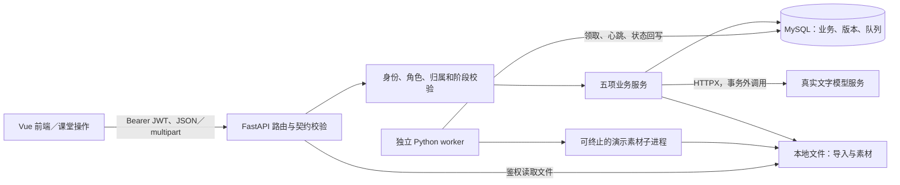
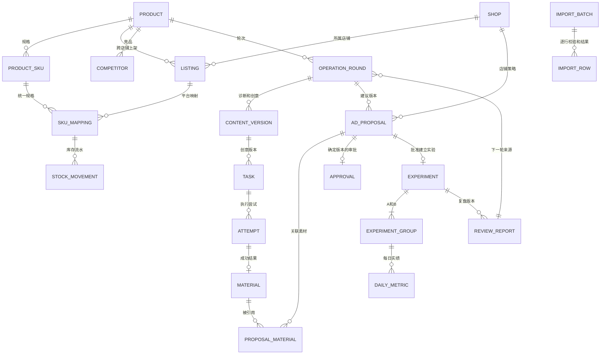
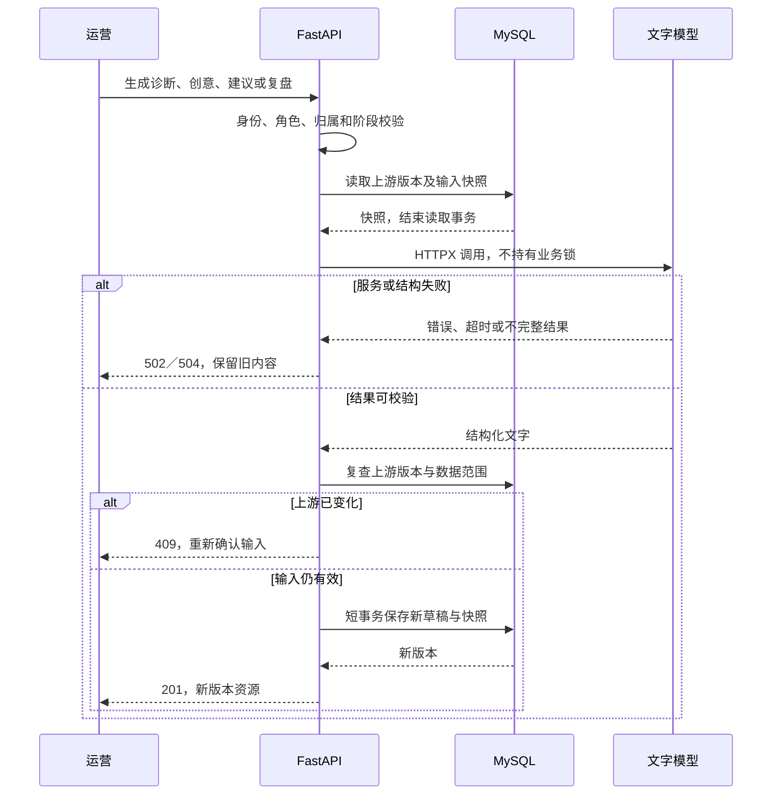
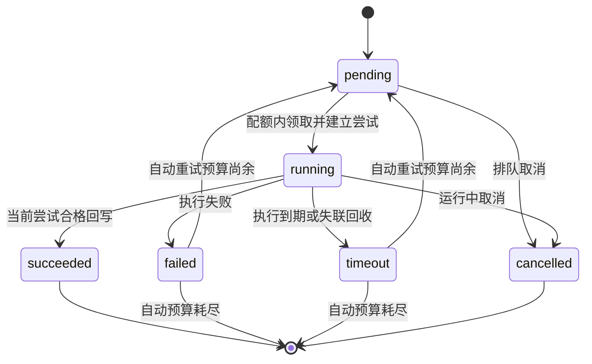
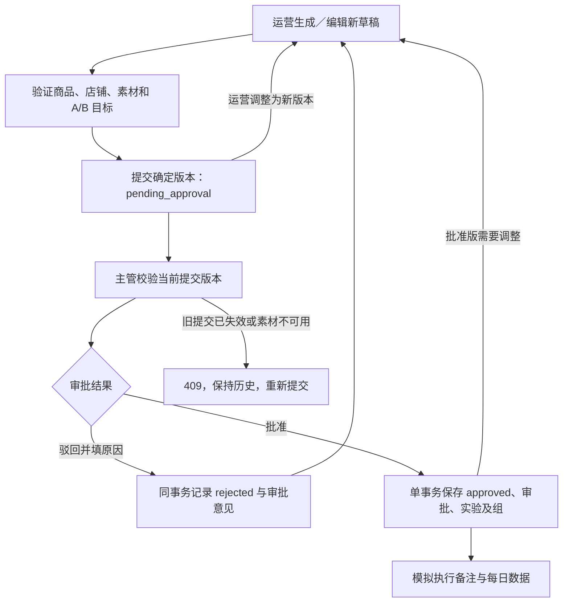
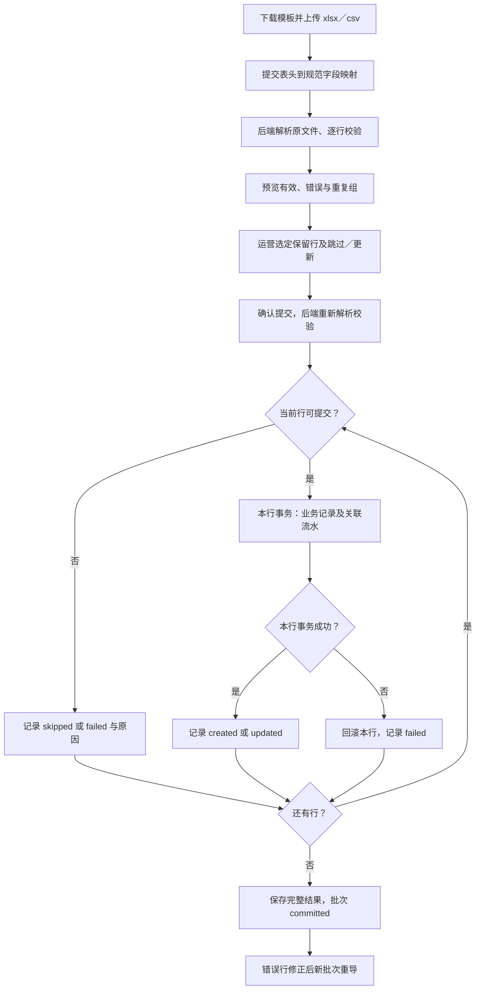

# 电商运营助手后端需求文档

版本：1.0。基线日期：2026-09-28。用途：学校教学项目的后端开发与联调。状态：**拟实现契约；软件验收未执行**。

## 1. 文档依据与使用方式

业务依据为 [原始需求](../Damend/Damend)、[项目执行规则](../AGENTS.md)、[总体开发规格](../SPEC.md) 和 [业务术语](../Damend/CONTEXT.md)。业务范围、角色和指标继续以这些已确认规则为基线；本文细化后端字段、接口、事务和验收证据，不另建一套产品需求。

本文中的英文命名、请求响应格式及数据字典是本次拟定的后端契约。用户已选择成功直接返回资源、错误统一返回 `code/message/details`。实现时若发现与基线冲突，先指出具体条目，确认后修改相关文档；不得通过调整接口绕过业务规则。确切依赖版本、字段物理长度和启动命令在实现并验证后记录，不把未验证内容写为运行事实。

当前工作区只有需求与规格文档，没有后端应用、迁移或可调用接口。`UNVERIFIED`：模型服务的实际兼容性、真实凭据可用性、运行环境与迁移执行结果。本次仅交付本文并添加入口，不开始软件开发。

阅读顺序：总体规格确定范围 → 本文第 2—4 节确定后端职责和对象 → 第 5—6 节确定契约 → 第 7—8 节确定执行规则 → 第 9—10 节确定运行准备与验收。

## 2. 范围、权限与模块

### 2.1 后端边界

| 项目 | 后端必须完成的行为 |
| --- | --- |
| 文字生成 | 诊断、主图方向、视频脚本、投放建议和复盘真实调用可配置的云端 Chat Completions 兼容服务；结构校验后保存可编辑版本。 |
| 图片与视频 | 使用 MySQL 持久化队列和独立 Python worker 返回演示图片及可播放视频；真实实现状态、心跳、重试、超时和取消。 |
| 店铺与竞品 | 模拟平台授权；竞品支持录入、表格导入和公开文本解析后人工核对，来源链接仅记录出处。 |
| 投放 | 运营提交，主管批准或驳回；批准建立课堂实验及执行备注，不连接广告账户或触发扣费。 |
| 数据与历史 | 商品跨店铺共用主档案；SKU 映射、库存、经营数据按店铺隔离；保留轮次、引用版本和报告快照。 |
| 完成标准 | 原需求 A1—A8 全部覆盖；完整防晒衣闭环包含两个店铺、至少 3 组主图、3 套脚本、图片与视频及 7 天 A/B 数据。 |

采用预置账号和单团队数据，不扩展注册、找回密码、多租户、真实素材服务、平台抓取或线上投放。

### 2.2 角色与权限

`operator` 为运营，`manager` 为主管／管理员。本文简称 O、M；R 表示两角色均可读取。身份、数据库中的当前角色及启用状态逐请求检查，界面隐藏按钮不代替后端鉴权。

| 操作 | O | M |
| --- | --- | --- |
| 读取大盘、商品、内容、任务、素材、实验、报告及导入结果 | 允许 | 允许 |
| 店铺基础档案、商品、SKU、上架、库存、竞品维护 | 允许 | 只读 |
| 内容生成、编辑、确认、归档及下一轮 | 允许 | 只读 |
| 素材任务提交、取消、重试、素材审核与打标 | 允许 | 只读 |
| 投放建议生成、编辑、提交及经营数据回填 | 允许 | 只读 |
| 投放确认或驳回 | 拒绝 | 允许 |
| 导入模板下载及结果读取 | 允许 | 允许 |
| 导入预览、重复行选择和提交 | 允许 | 拒绝 |
| 服务／队列配置读取、更新及模拟授权维护 | 拒绝 | 允许 |

### 2.3 技术职责

沿用 SPEC 第 2 节，不引入新框架：Python FastAPI／Uvicorn／Pydantic 2；SQLAlchemy 2／PyMySQL／Alembic／MySQL 8.0；HTTPX；PyJWT 与 pwdlib Argon2；openpyxl 与 csv；独立 worker；本地文件；pytest。

| 模块 | 职责与完成证据 |
| --- | --- |
| 商品与竞品管理 | 主档案、规格、上架、映射、库存流水、竞品及核对；能查询跨店铺归属和变更记录。 |
| 内容生成引擎 | 真实模型调用、输入快照、诊断／创意结构校验、编辑和版本保存；不完整结果不能确认。 |
| 异步任务调度引擎 | 入队、短事务领取、执行尝试、心跳、并发、超时、重试和取消；迟到回写不能覆盖当前状态。 |
| 投放与复盘分析 | 建议版本、主管审批、实验、每日原始值、确定性指标及五部分复盘；目标与实际可追溯。 |
| 导入与数据校验 | 模板、文件解析、字段映射、归属和重复校验、按行事务、逐行反馈；有效行可部分成功。 |

认证、服务配置、数据库会话与本地文件读取为上述模块共用能力。路由处理 HTTP，Pydantic 定义输入输出，业务服务落实权限与阶段规则，SQLAlchemy 落实事务，worker 执行独立任务。



## 3. 通用契约

### 3.1 命名、类型与序列化

- 所有路径加 `/api` 前缀，第 5 节省略该前缀。除登录外都携带 `Authorization: Bearer <token>`，文件读取同样鉴权。
- 字段采用 `snake_case`。数据库资源标识为正整数；编码为字符串。金额请求及响应采用十进制字符串，例如 `"299.00"`，数据库采用 Decimal／DECIMAL，计算不使用二进制浮点金额。
- 业务日期为 `YYYY-MM-DD`，按 Asia/Shanghai 自然日理解；操作时间以 UTC 保存，响应为带时区的 ISO 8601，例如 `2026-09-28T01:00:00Z`。
- 比率数值不放大为百分数：`ctr: 0.025` 表示 2.50%；ROI 为倍数。分母为零返回 `null` 和 `zero_denominator` 原因；缺失返回 `null` 和 `missing_data`，不能以零替代。
- PATCH 中省略的字段保持原值；显式 `null` 只允许用于可空字段。身份、审批人、库存差额、派生指标等服务端字段不能由客户端覆盖。
- 列表统一支持 `page`、`page_size`，默认 1、20；返回 `items/total/page/page_size`。筛选使用相应的 `product_id`、`round_id`、`shop_id`、`status` 或 `date_from/date_to`；稳定按标识排序，任务时间线按尝试序号排序。
- 前置条件或版本冲突不清空旧内容。引用资源同时检查商品、轮次、店铺及版本归属，不仅检查 ID 是否存在。

以下 JSON 块均为合法的合成教学示例；其中密码和 token 只是占位字符串，不是可用账号或凭据。

```json
{
  "items": [{"id": 1, "product_code": "SUN-001", "name": "夏季凉感防晒衣", "base_price": "299.00"}],
  "total": 1,
  "page": 1,
  "page_size": 20
}
```

### 3.2 HTTP 状态与错误

| HTTP | 用途 |
| --- | --- |
| 200 | 读取、普通更新、确认及动作成功。 |
| 201 | 创建资源，包括新内容版本、实验、报告或导入预览批次。 |
| 202 | 接受异步图片／视频任务，响应已经持久化的任务。 |
| 401／403 | 身份无效／当前角色不允许。 |
| 404 | 资源不存在。 |
| 409 | 唯一键、当前状态、引用版本或重复业务动作冲突。 |
| 422 | 字段、行数据、引用归属或结构要求不合法。 |
| 502／504 | 真实模型服务异常或结构无法校验／模型请求超时。 |

错误体统一为 `code: string`、`message: string`、`details: array`。每项明细包含 `field: string|null`、`row_number: integer|null`、`reason: string`；列表为空代表没有字段明细。业务代码采用本文语义，例如 `role_forbidden`、`state_conflict`、`version_conflict`、`duplicate_record`、`invalid_reference`、`validation_error`、`model_unavailable`、`model_output_invalid`、`model_timeout`。预览内逐行错误使用同样的明细结构，但预览请求整体成功不返回 HTTP 422。

```json
{
  "code": "role_forbidden",
  "message": "仅主管／管理员可以审批投放建议",
  "details": []
}
```

```json
{
  "code": "validation_error",
  "message": "经营数据未通过校验",
  "details": [{"field": "ad_spend", "row_number": 15, "reason": "金额不能为负数"}]
}
```

### 3.3 状态及版本公共字段

| 对象 | 契约状态 | 变更规则 |
| --- | --- | --- |
| 诊断、创意、报告 | `draft/confirmed/archived` | 生成或编辑得到草稿；完整校验后确认；归档保留历史引用。 |
| 素材 | `pending_review/usable/rejected`，另有 `archived_at` | 成功先待审核；审核通过且未归档才可被新建议选择。 |
| 建议版本 | `draft/pending_approval/rejected/approved` | 运营提交，主管决定；调整保存新版本，再提交审批。 |
| 生成任务 | `pending/running/succeeded/failed/timeout/cancelled` | 任务与尝试分开；自动预算耗尽后的失败／超时才是任务终态。 |
| 竞品核对 | `unverified/verified` | 手工核对后参与诊断，解析和导入不能直接标记已核对。 |

版本资源返回 `id/product_id/round_id/version/status/created_at`，并按对象返回上游版本及快照。编辑接口输入 `expected_version`，核对目标版本及该作用域当前版本，旧版本被新版本替代后的编辑请求返回 409。内容、报告和建议 PATCH 都返回**新版本资源**，旧版本不可被覆盖；客户端后续动作使用返回的新 ID。

轮次 `phase` 采用 `setup/diagnosis/creative/material/ad/data/review`，它是由完成证据推导的展示阶段，不接受任意 PATCH。失败保留先前记录；后端以实际前置条件判定能否操作。

## 4. 数据字典与关系

### 4.1 字典记法与公共字段

下表使用 `字段:逻辑类型`；`?` 表示可空，`[]` 表示数组。没有 `?` 的持久化字段必须有值，但可由服务端生成，不能据此认为创建请求全部必填。`id/ref` 为整数，`text` 为字符串，`money` 为十进制金额，`count` 为非负整数，`date/time` 为业务日期／UTC 时间，`json` 为结构化对象，`bool` 为布尔值。

资源表均有服务端生成的 `id`、`created_at`；可变资源记录 `updated_at`。写入记录包含 `created_by`，可变资源记录 `updated_by`，引用用户。只追加的尝试、审批、流水保留实际执行人或调度身份。密钥及密码散列为内部字段，任何业务响应都不返回。

### 4.2 核心对象字段

| 对象／拟表 | 字段及可空性 | 归属与约束 |
| --- | --- | --- |
| 用户 `users` | `username:text; password_hash:text; role:enum; enabled:bool` | username 唯一；role 为 operator 或 manager；密码仅保存散列。 |
| 店铺 `shops` | `shop_code:text; platform:text; name:text; platform_shop_id:text; authorization_status:text` | shop_code 唯一；authorization_status 是脱敏模拟授权状态。 |
| 商品 `products` | `product_code:text; name:text; category:text; attributes:json; base_price:money; main_sku_id:ref?` | product_code 唯一；主推 SKU 必须属于本商品；售价为正。 |
| 规格 `product_skus` | `product_id:ref; sku_code:text; attributes:json` | `(product_id,sku_code)` 唯一；属性包括颜色／尺码。 |
| 上架 `shop_listings` | `product_id:ref; shop_id:ref; platform_product_id:text; on_sale:bool` | `(shop_id,product_id)` 唯一；店铺售价从下属 SKU 映射维护。 |
| 映射 `sku_mappings` | `listing_id:ref; sku_id:ref; platform_sku_id:text; sale_price:money; stock_quantity:count; warning_threshold:count` | `(listing_id,sku_id)` 唯一；SKU 属于上架商品；库存仅通过库存动作修改。 |
| 库存流水 `stock_movements` | `sku_mapping_id:ref; before_quantity:count; after_quantity:count; delta:integer; reason:text; source:enum; actor_id:ref` | delta 可负，等于 after−before；source 为 `manual/import`；与库存同事务。 |
| 竞品 `competitors` | `product_id:ref; competitor_code:text; platform:text?; name:text; price:money; attributes:json; selling_points:text[]; source_url:text?; source_text:text?; verification_status:enum` | `(product_id,competitor_code)` 唯一；至少一份 verified 竞品参与诊断；价格为正。 |
| 轮次 `operation_rounds` | `product_id:ref; round_number:integer; phase:enum; source_report_id:ref?; selected_actions:json[]` | `(product_id,round_number)` 唯一；首轮无来源，下一轮来源报告属于同商品。 |
| 内容 `content_versions` | `product_id:ref; round_id:ref; kind:enum; version:integer; status:enum; content:json; edited_content:json?; upstream_content_id:ref?; input_snapshot:json; confirmed_at:time?; archived_at:time?` | kind=`diagnosis/creative`；`(round_id,kind,version)` 唯一；创意关联诊断；输入及被引用版本保留。 |
| 任务 `generation_tasks` | `product_id:ref; round_id:ref; creative_content_id:ref; selection_id:text; task_type:enum; status:enum; current_attempt_id:ref?; config_snapshot:json; original_task_id:ref?; demo_scenario:enum; cancelled_at:time?; cancel_reason:text?` | task_type=`image/video`；pending 可无尝试；人工重试关联原任务；选定项属于该创意版本；读取的计算字段见 §5.6。 |
| 尝试 `task_attempts` | `task_id:ref; attempt_number:integer; execution_id:text; status:enum; started_at:time; finished_at:time?; heartbeat_at:time; deadline_at:time; error_code:text?; error_message:text?` | `(task_id,attempt_number)` 唯一；execution_id 标识本次执行；状态为 running/succeeded/failed/timeout/cancelled。 |
| 素材 `materials` | `product_id:ref; round_id:ref; creative_content_id:ref; task_id:ref; attempt_id:ref; material_type:enum; version:integer; storage_path:text; mime_type:text; is_demo:bool; review_status:enum; review_comment:text?; reviewed_by:ref?; reviewed_at:time?; tags:text[]; archived_at:time?` | 成功尝试最多一份素材；版本按创意选定项与类型递增；路径内部保存，响应给受保护文件接口。 |
| 建议 `ad_proposals` | `product_id:ref; round_id:ref; shop_id:ref; proposal_key:text; version:integer; status:enum; diagnosis_content_id:ref; creative_content_id:ref; strategy:json; groups:json[]; targets:json; material_snapshot:json[]; date_from:date; date_to:date; input_snapshot:json; content_confirmed_at:time?; content_confirmed_by:ref?; archived_at:time?` | `(proposal_key,version)` 唯一；proposal_key 由服务端生成，连接同一建议各版；content_confirmed 由时间推导，确认不授予批准；素材关联见下文。 |
| 审批 `approval_records` | `proposal_id:ref; decision:enum; reviewer_id:ref; reviewed_at:time; comment:text` | decision=`approved/rejected`；一份提交版本只产生一次有效决定；拒绝时 comment 非空。 |
| 实验 `ad_experiments` | `experiment_code:text; approved_proposal_id:ref; product_id:ref; round_id:ref; shop_id:ref; date_from:date; date_to:date; target_snapshot:json; execution_note:text; period_closed:bool; review_scope:json?` | 实验编码及 approved_proposal_id 唯一；归属由批准建议推导，不能客户端另指定。 |
| 实验组 `experiment_groups` | `experiment_id:ref; group_code:text; material_snapshot:json[]; audience:json; bid:money; budget:money; targets:json` | `(experiment_id,group_code)` 唯一；教学为 A/B 两组；批准后保留策略快照。 |
| 每日数据 `daily_metrics` | `date:date; shop_id:ref; product_id:ref; experiment_id:ref; group_id:ref; impressions:count; clicks:count; orders:count; gmv:money; ad_spend:money; detail_visits:count?; detail_bounces:count?` | 五维唯一键见 4.3；详情字段成对可空且 bounces≤visits；GMV、花费非负。 |
| 报告 `review_reports` | `product_id:ref; round_id:ref; shop_id:ref; experiment_id:ref; version:integer; status:enum; data_scope:json; data_snapshot:json; target_snapshot:json; actual_metrics:json; sections:json; actions:json[]; confirmed_at:time?; archived_at:time?` | `(experiment_id,version)` 唯一；五部分见 6.7；编辑叙述不改指标与快照。 |
| 导入批次 `import_batches` | `import_type:enum; storage_path:text; field_mapping:json; sheet_name:text?; status:enum; summary:json; submitted_by:ref?; submitted_at:time?` | type=`products/inventory/competitors/metrics`；status=`previewed/committing/committed`；工作表及提交占用见 §5.6；预览不改业务数据。 |
| 导入行 `import_rows` | `batch_id:ref; row_number:integer; normalized_data:json; validation_status:enum; details:json[]; duplicate_group:text?; existing_resource_id:ref?; resolution:enum?; commit_result:enum?` | `(batch_id,row_number)` 唯一；校验为 `valid/invalid/duplicate`；选择为 `keep/skip/update`；结果为 `created/updated/skipped/failed`。 |
| 配置 `service_configs` | `config_type:enum; values:json; api_key_ciphertext:text?` | 服务与队列配置分别单例；api_key 只在后端加密存储；队列单例也是配额锁定记录。 |

建议与素材另保存关联 `proposal_materials(proposal_id,material_id)`，组合唯一；这是落实 SPEC 中素材关联记录的拟表名。素材 ID 引用与快照同时保留，避免归档后历史建议断链。JSON 中的引用也逐项校验，不能以 JSON 存储为理由省略归属检查。

### 4.3 必须落实的唯一键与事务

- 每日数据唯一键：`(date,shop_id,product_id,experiment_id,group_id)`。同键更新替换原值，不叠加金额、订单或计数。
- 库存：读取并锁定映射 → 更新目标库存 → 写流水，在同一事务提交。新映射的初始库存也记录由零到目标值的流水；阈值和价格修改不伪造库存流水。
- 审批：校验 pending_approval 版本及素材 → 保存决定 → 批准时创建实验和组，单事务提交，失败整体回滚。相同版本重复决定返回 409。
- 任务：短事务领取并登记尝试；执行在事务外；成功回写与素材登记同事务并核对当前尝试身份。文件由应用与事务结果协调，数据库回滚不能留下可用素材记录。
- 导入：每行独立事务，库存行包含库存与流水。批次记录逐行结果，不以整个文件回滚代替部分成功。
- 内容和报告：同作用域版本号唯一，版本分配与保存采用短事务；已引用版本、旧报告数据及已批准实验不覆盖。



## 5. 接口清单

### 5.1 表格约定

`资源名` 响应指第 4 节的公共字段与业务字段，排除密码散列、加密密钥、执行内部身份及本地绝对路径；素材以 `file_url` 代替 `storage_path`。`列表` 使用第 3 节分页体。嵌套内容、策略、任务和报告的精确结构见第 6 节。读取接口不修改业务数据。

下面输入中没有标记 `?` 的创建／动作参数必填；`?` 为可选。PATCH 的允许字段均可省略，但请求必须实际包含要修改的字段；版本型编辑另须 `expected_version`。路径 ID 必填且为正整数。通用 401、403、404、422 适用于所有相应接口；表中只列额外业务失败。写事务简称 T，事务外文字模型调用简称 L。

### 5.2 认证、大盘、商品与竞品

| 方法与路径 | 角色 | 输入 | 成功响应 | 前置条件／事务／额外失败 |
| --- | --- | --- | --- | --- |
| `POST /auth/login` | 未登录 | `username,password` | 200：`access_token,token_type,expires_in,user` | 启用用户、密码正确；失败 401；不回传密码。 |
| `GET /auth/me` | R | 无 | 200：`id,username,role,enabled` | 验签、有效期及当前用户状态。 |
| `GET /dashboard` | R | query：`shop_id?,date_from?,date_to?` | 200：`date_from,date_to,product_count,on_sale_product_count,active_product_count,sell_through_rate,metric_reasons,totals,metrics,trend,inventory_alerts,shops` | 默认近 7 天；区间聚合见 8.2；预警含 shop/listing/SKU 标识。 |
| `GET /shops` | R | 分页、`platform?` | 200：店铺列表 | 授权状态为脱敏值。 |
| `POST /shops` | O | `shop_code,platform,name,platform_shop_id` | 201：店铺 | T；初始授权 `not_configured`；重复编码 409。 |
| `PATCH /shops/{id}` | O | `name,platform,platform_shop_id` 的待改字段 | 200：店铺 | T；不允许此入口改授权状态。 |
| `GET /products` | R | 分页、`keyword?,shop_id?` | 200：商品列表 | 店铺筛选经上架关系；按统一商品去重。 |
| `POST /products` | O | `product_code,name,category,base_price,attributes?` | 201：商品 | T；初始属性 `{}`、主推规格空；重复编码 409。 |
| `GET /products/{id}` | R | 无 | 200：商品及 `skus,listings,rounds` 摘要 | rounds 摘要含各轮 `phase` 和内容、建议、实验、报告的资源 ID／版本索引，供工作台继续读取。 |
| `PATCH /products/{id}` | O | `name,category,base_price,attributes,main_sku_id` 的待改字段 | 200：商品 | T；主推 SKU 属于商品，旧内容快照保持。 |
| `GET /products/{id}/skus` | R | 分页 | 200：SKU 列表 | 商品存在。 |
| `POST /products/{id}/skus` | O | `sku_code,attributes` | 201：SKU | T；商品内编码重复 409。 |
| `PATCH /skus/{id}` | O | `attributes` | 200：SKU | T；不改变商品归属或已引用快照。 |
| `GET /products/{id}/listings` | R | 分页、`shop_id?` | 200：上架列表 | 响应含 `sku_mappings`，避免按店铺另造商品主档案。 |
| `POST /products/{id}/listings` | O | `shop_id,platform_product_id,on_sale` | 201：上架 | T；店铺存在；商品店铺组合重复 409。 |
| `PATCH /listings/{id}` | O | `platform_product_id,on_sale` 的待改字段 | 200：上架 | T；归属不可移转；售价走映射接口。 |
| `GET /listings/{id}/sku-mappings` | R | 分页 | 200：映射列表 | 库存属于该店铺。 |
| `POST /listings/{id}/sku-mappings` | O | `sku_id,platform_sku_id,sale_price,stock_quantity,warning_threshold` | 201：映射 | T；同商品 SKU；初始库存及流水一起提交；映射重复 409。 |
| `PATCH /sku-mappings/{id}` | O | `platform_sku_id,sale_price,warning_threshold` 的待改字段 | 200：映射 | T；此入口不允许直接改库存。 |
| `POST /sku-mappings/{id}/stock-adjustments` | O | `stock_quantity,reason` | 200：`sku_mapping,stock_movement` | 锁定映射，库存及流水同 T；输入为目标库存。 |
| `GET /sku-mappings/{id}/stock-movements` | R | 分页 | 200：流水列表 | 返回 before、after、delta、来源、操作人和时间。 |
| `GET /products/{id}/competitors` | R | 分页、`verification_status?` | 200：竞品列表 | 仅当前商品。 |
| `POST /products/{id}/competitors` | O | `competitor_code,name,price,attributes,selling_points,platform?,source_url?,source_text?` | 201：待核对竞品 | T；商品内编码重复 409；默认 unverified。 |
| `POST /products/{id}/competitors/parse` | O | `source_text,source_url?` | 200：`parsed_data,verification_status` | L 解析，返回 unverified 的待核对候选，不直接写已核对档案；模型失败 502／504。 |
| `PATCH /competitors/{id}` | O | 上述资料字段及 `verification_status` 的待改字段 | 200：竞品 | T；核对后可设 verified；关键资料修改需重新核对，不把旧核对当新事实。 |
| `GET /products/{id}/rounds` | R | 分页 | 200：轮次列表及资源索引 | 包含阶段及下一轮来源，历史可读。 |
| `POST /products/{id}/rounds` | O | 无 | 201：首轮 | T；已有轮次时返回 409，后续轮次经报告 next-round 创建。 |

### 5.3 内容、任务及素材

| 方法与路径 | 角色 | 输入 | 成功响应 | 前置条件／事务／额外失败 |
| --- | --- | --- | --- | --- |
| `POST /rounds/{id}/diagnoses/generate` | O | `instructions?` | 201：诊断内容版本 | 商品资料及至少一份 verified 竞品；快照→L→上游复查→T；模型 502／504，版本变化 409。 |
| `POST /rounds/{id}/creatives/generate` | O | `diagnosis_content_id,instructions?` | 201：创意内容版本 | 同商品同轮次 confirmed 诊断；L 后校验主图≥3、脚本≥3，再 T；结构错误 502。 |
| `GET /contents/{id}` | R | 无 | 200：诊断／创意版本 | 返回 content、编辑内容、上游 ID、状态及版本。 |
| `PATCH /contents/{id}` | O | `expected_version,content,edited_content?` | 201：新草稿版本 | T；按 kind 重新校验；旧版本保留；版本冲突 409。 |
| `POST /contents/{id}/confirm` | O | `expected_version` | 200：confirmed 内容 | T；字段与数量齐全、创意选定项有效；已归档或版本冲突 409。 |
| `POST /contents/{id}/archive` | O | `expected_version` | 200：archived 内容 | T；保留历史引用，新下游不能选择归档版本。 |
| `GET /tasks` | R | 分页、`product_id?,round_id?,status?,task_type?` | 200：任务列表 | 终态与可重试标识见 6.4。 |
| `POST /tasks` | O | `creative_content_id,selection_id,task_type,demo_scenario?` | 202：pending 任务 | 创意 confirmed、选定项属于该版本、类型匹配；T 入队及配置快照。 |
| `GET /tasks/{id}` | R | 无 | 200：任务、`attempts,terminal,retry_available,material_id` | 查询持久化状态；material_id 可空。 |
| `POST /tasks/{id}/cancel` | O | 无 | 200：cancelled 任务 | 仅 pending／running；T 标记、终止后续重试；其他状态 409。 |
| `POST /tasks/{id}/retry` | O | 无 | 202：关联原任务的新 pending 任务 | 仅预算耗尽的 failed／timeout；重新检查创意；旧任务不复活，其他状态 409。 |
| `GET /materials` | R | 分页、`product_id?,round_id?,review_status?,include_archived?` | 200：素材列表 | 默认不包含归档；显式 include_archived=true 可查看历史。 |
| `GET /materials/{id}/file` | R | 无 | 200：图片／视频文件 | 检查素材归属及路径；文件缺失 404；支持浏览器视频播放所需的范围读取。 |
| `POST /materials/{id}/review` | O | `decision,comment?` | 200：素材 | decision=`usable/rejected`；T 写审核人和时间；归档素材拒绝新审核 409。 |
| `PATCH /materials/{id}/tags` | O | `tags` | 200：素材 | T；tags 为字符串数组。 |
| `POST /materials/{id}/archive` | O | 无 | 200：素材及 archived_at | T；历史文件和引用保留。 |

### 5.4 投放、经营与复盘

| 方法与路径 | 角色 | 输入 | 成功响应 | 前置条件／事务／额外失败 |
| --- | --- | --- | --- | --- |
| `POST /rounds/{id}/ad-proposals/generate` | O | `shop_id,diagnosis_content_id,creative_content_id,material_ids,date_from,date_to,targets,instructions?` | 201：建议草稿版本 | 同商品店铺上架；前序内容已确认；素材可用未归档；L→复查→T；模型 502／504、变化 409。 |
| `GET /ad-proposals/{id}` | R | 无 | 200：建议及 `approvals,experiment_id` | experiment_id 可空；返回版本和素材快照。 |
| `PATCH /ad-proposals/{id}` | O | `expected_version,strategy,groups,targets,date_from,date_to,material_ids` | 201：新建议草稿 | T；完整策略重新校验；批准版编辑不迁移旧实验；版本冲突 409。 |
| `POST /ad-proposals/{id}/submit` | O | `expected_version` | 200：pending_approval 建议 | T；当前未归档草稿且 content_confirmed=true；再核验可用素材、分组及目标，状态／版本冲突 409。 |
| `POST /ad-proposals/{id}/confirm` | O | `expected_version` | 200：建议，content_confirmed=true | T；当前未归档 draft、结构完整；写 content_confirmed_at/by，审批 status 保持 draft。 |
| `POST /ad-proposals/{id}/archive` | O | `expected_version` | 200：建议及 archived_at | T；保留原审批状态与历史；待审退出审批，已批实验及实绩仍可读。 |
| `POST /ad-proposals/{id}/approve` | M | `expected_version,comment?` | 201：`proposal,approval,experiment` | 待审批版本、素材仍可用；审批＋实验＋A/B 同 T；重复审批 409。 |
| `POST /ad-proposals/{id}/reject` | M | `expected_version,comment` | 200：`proposal,approval` | comment 必填非空；T；待审批，否则 409。 |
| `GET /experiments/{id}` | R | 无 | 200：实验及 `groups,reviews` 索引 | 实验对应批准版本，返回目标、周期及执行备注。 |
| `PATCH /experiments/{id}/execution-note` | O | `execution_note` | 200：实验 | T；只记录课堂模拟说明，不触发外部执行。 |
| `GET /experiments/{id}/metrics` | R | 分页、`group_code?,date_from?,date_to?` | 200：每日列表及 `totals,metrics,metric_reasons,data_completeness` | 汇总覆盖全部筛选行，不只当前分页；按原始和计算。 |
| `POST /experiments/{id}/metrics` | O | 第 6.6 节每日写入字段 | 201：每日记录及派生指标 | T；组别和日期归属正确；同五维重复 409，提示选择更新。 |
| `PATCH /metrics/{id}` | O | 原始计数／金额／详情字段的待改字段 | 200：每日记录及派生指标 | T；不改变五维归属；旧报告快照不变，重生成新报告。 |
| `POST /experiments/{id}/close-period` | O | `date_from,date_to` | 201：`experiment,report` | 周期已结束、有有效数据、范围在周期内；先 T 保存范围，再 L 生成报告；失败 502／504 保留已确认范围。 |
| `POST /experiments/{id}/reviews/generate` | O | 无 | 201：新报告版本 | 复盘范围已确认；重新快照和计算后 L；原数据变化 409，模型 502／504；用于重试或数据修正后再生成。 |
| `GET /reviews/{id}` | R | 无 | 200：报告 | 五部分、事实／推测、行动、目标与数据快照。 |
| `PATCH /reviews/{id}` | O | `expected_version,sections,actions` | 201：新草稿报告 | T；仅编辑分析叙述和行动；数据／计算字段不可覆盖。 |
| `POST /reviews/{id}/confirm` | O | `expected_version` | 200：confirmed 报告 | T；五部分完整，动作结构有效；状态／版本冲突 409。 |
| `POST /reviews/{id}/archive` | O | `expected_version` | 200：archived 报告 | T；保留来源和历史快照。 |
| `POST /reviews/{id}/next-round` | O | `expected_version,action_ids` | 201：`round,diagnosis` | confirmed 报告、至少一项有效行动；先 T 建下一轮，再自动 L 诊断；失败保留新轮次并可重试诊断，见 7.4。 |

### 5.5 导入与配置

| 方法与路径 | 角色 | 输入 | 成功响应 | 前置条件／事务／额外失败 |
| --- | --- | --- | --- | --- |
| `GET /imports/templates/{type}` | R | type 为四种模板，query：`format=xlsx/csv` | 200：附件文件 | 只允许四种模板；不存在的类型 422；格式默认 xlsx。 |
| `POST /imports/preview` | O | multipart：`file,import_type,field_mapping,sheet_name?` | 201：导入批次及逐行预览 | 后端读原文件；xlsx 默认首工作表，CSV 不选工作表；T 保存文件归属与预览，不写业务数据；不可解析或工作表不存在 422。 |
| `POST /imports/{id}/commit` | O | `row_resolutions` | 200：批次及结果 | 后端再次解析校验；每有效行 T；重复选择见 6.8；已 committed 再提交 409。 |
| `GET /imports/{id}` | R | query：`page?,page_size?` | 200：批次、`rows` 分页及完整 summary | 行号、错误、冲突和提交结果均可追溯。 |
| `GET /settings/services` | M | 无 | 200：脱敏服务配置 | 返回 `api_key_configured,api_key_masked`，不返回原密钥。 |
| `PATCH /settings/services` | M | `base_url,model,temperature,request_timeout_seconds,multimodal_mode` 的待改字段，`api_key?` | 200：脱敏配置 | T；mode 仅 simulation；密钥加密保存；省略 api_key 保留旧值。 |
| `GET /settings/queue` | M | 无 | 200：队列配置 | 返回并发、期限、重试、轮询、调度及心跳参数。 |
| `PATCH /settings/queue` | M | 第 7.2 节参数的待改字段 | 200：队列配置 | T；参数类型有效；配额改变用于之后领取，不终止既有运行。 |
| `PATCH /settings/shops/{id}/authorization` | M | `authorization_status` | 200：店铺 | T；模拟状态=`not_configured/authorized/expired`；不接受平台密码或 Cookie。 |

### 5.6 与后端开发流程同步的联调补充

2026-09-28 同步 [后端开发流程第 10 节](后端开发流程文档.md)已确定的补充；本节补齐本文早期 70 个接口的口径，现在方法与路径共 72 个。既有请求响应格式不变；以下都是待实现的读取及动作字段。

| 对象／入口 | 明确字段与规则 |
| --- | --- |
| 建议 | 增加 content_confirmed_at:time?、content_confirmed_by:ref?、archived_at:time?，响应 content_confirmed:bool。submit 必须当前未归档 draft 且内容已确认；PATCH 新版清空确认与归档信息。审批前仍检查当前版本及素材。 |
| 轮次及商品 rounds 摘要 | resource_index:{contents:array,ad_proposals:array,experiments:array,reviews:array}；各项返回 id、product_id、round_id 及适用的 kind/version/status/shop_id/archived_at。建议项含 proposal_key、content_confirmed、is_current；GET 详情按索引 ID 继续读快照。 |
| 任务列表和详情 | 返回 poll_interval_seconds、config_snapshot、original_task_id、terminal、retry_available、attempts、material_id、cancelled_at:time?、cancel_reason:text?；queued_at:time 在尝试响应中按提交或上次尝试结束推导，不新增必须存储的队列时间表。 |
| preview 与批次 | multipart 增加 sheet_name?；批次保存并回显 sheet_name:text?。xlsx 默认首表，CSV null；无效工作表 422。GET 批次的 rows 为分页对象 items/total/page/page_size，summary 为整批，不能只导出当前页。 |
| 提交恢复 | committing 为内部持久化占用状态，对结果查询可见；未完成只查询进展，不自动重复提交已写行；修正剩余行使用新批次及重复策略。 |
| 历史读取 | 原版本及适用快照与归属一并返回；归档待审不新建 rejected 审批；已批归档不取消旧实验。 |

下方早期示例只列核心字段，完整 Schema 加上本节适用字段。文末原文档的 70 项检查记录为当时检查，本次 72 项同步不代表接口已实现。

## 6. 请求、响应及结构化内容

### 6.1 登录与配置示例

JWT 默认有效期 8 小时，`expires_in` 单位为秒。未提供注册、刷新 token 或退出后端会话接口；退出由前端清除凭据，过期重新登录。后台每次仍读取用户当前角色与启用状态。

```json
{
  "request": {"username": "operator", "password": "<课堂账号密码>"},
  "response": {
    "access_token": "<JWT>", "token_type": "bearer", "expires_in": 28800,
    "user": {"id": 1, "username": "operator", "role": "operator", "enabled": true}
  }
}
```

服务配置 `base_url/model` 为字符串，temperature 为数值，request_timeout_seconds 为正整数，mode 为 simulation。没有请求 api_key 时保留已有值，显式空值不当作新的有效密钥。更新日志只记录修改字段和操作人，不记录原始密钥。

```json
{
  "request": {"model": "<已配置模型名>", "request_timeout_seconds": 60, "multimodal_mode": "simulation"},
  "response": {
    "base_url": "https://example.invalid/v1", "model": "<已配置模型名>",
    "temperature": 0.7, "request_timeout_seconds": 60, "multimodal_mode": "simulation",
    "api_key_configured": true, "api_key_masked": "******", "updated_by": 2
  }
}
```

### 6.2 商品、竞品与库存

创建请求遵循 5.2 的必填字段及第 4 节类型；库存数量和阈值非负整数，商品、规格售价和竞品价格为正金额。规格 attributes 为业务属性对象，不固定只允许颜色和尺码。竞品公开文本解析返回候选 `name/price/attributes/selling_points/platform/source_url/source_text`，无法提取的字段返回空或缺失明细，运营补齐后再录入、核对。

```json
{
  "product_request": {"product_code": "SUN-001", "name": "夏季凉感防晒衣", "category": "服饰", "base_price": "299.00", "attributes": {"season": "夏季"}},
  "sku_request": {"sku_code": "BLUE-S", "attributes": {"color": "蓝色", "size": "S"}},
  "listing_request": {"shop_id": 1, "platform_product_id": "DEMO-P-001", "on_sale": true},
  "mapping_request": {"sku_id": 1, "platform_sku_id": "DEMO-SKU-001", "sale_price": "299.00", "stock_quantity": 8, "warning_threshold": 10},
  "stock_request": {"stock_quantity": 20, "reason": "课堂库存调整"},
  "stock_response": {
    "sku_mapping": {"id": 1, "stock_quantity": 20, "warning_threshold": 10},
    "stock_movement": {"id": 2, "sku_mapping_id": 1, "before_quantity": 8, "after_quantity": 20, "delta": 12, "reason": "课堂库存调整", "source": "manual", "actor_id": 1}
  },
  "competitor_request": {"competitor_code": "C-001", "name": "教学竞品甲", "price": "269.00", "attributes": {"sun_protection": "示例参数"}, "selling_points": ["透气"], "source_text": "合成教学商品资料"}
}
```

示例 stock_response 只列动作核心字段；完整映射响应还包含第 4 节公有字段。两个店铺关联同一 product_id，分别建立映射及库存，不能复制主档案来实现跨店铺。

### 6.3 诊断与创意模型

`DiagnosisContent` 必含以下字段：`target_audience:string[]`、`price_band_analysis:string`、`selling_point_matrix:array`（每项 `selling_point/evidence/recommendation:string`）、`conversion_bottlenecks:string[]`、`optimization_directions:string[]`。

`CreativeContent` 必含 `image_directions:array`、`video_scripts:array`，数量分别至少 3；`selected_image_ids:string[]`、`selected_video_ids:string[]` 初始可为空，任务必须选定有效项。

- 主图项：`selection_id/title/layout/core_copy/main_selling_point/visual_advice` 均为字符串。
- 视频项：`selection_id/title/hook_3s/cta` 为字符串，`shots` 为非空数组；每镜头 `scene_description/voiceover` 为字符串。
- selection_id 在该创意版本中唯一，编辑后选择引用仍须有效。图片任务选定项须在 selected_image_ids 中，视频须在 selected_video_ids 中，且类型匹配。`edited_content` 为可空 Quill Delta 对象，结构化 content 是校验及下游引用依据，富文本不能替代必需字段。
- 生成接口响应包含内容资源及 `content`，上述字段均须通过 Pydantic 校验。运营编辑同样校验；数量或字段缺失返回 422，模型生成不合格返回 502，均不保存已确认的残缺结果。

```json
{
  "diagnosis_request": {"instructions": "关注凉感透气卖点"},
  "diagnosis_content": {
    "target_audience": ["夏季通勤及轻户外人群"],
    "price_band_analysis": "依据录入售价与竞品价格比较",
    "selling_point_matrix": [{"selling_point": "凉感透气", "evidence": "教学档案中的产品描述，尚需实际验证", "recommendation": "补充面料展示"}],
    "conversion_bottlenecks": ["面料信息表达不足属于待验证推测"],
    "optimization_directions": ["设计面料特写内容"]
  },
  "creative_request": {"diagnosis_content_id": 11, "instructions": "分别呈现通勤、户外及面料"},
  "creative_content": {
    "image_directions": [
      {"selection_id": "IMG-1", "title": "通勤", "layout": "人物与文案分区", "core_copy": "夏日轻装", "main_selling_point": "凉感", "visual_advice": "浅色背景"},
      {"selection_id": "IMG-2", "title": "户外", "layout": "人物全景", "core_copy": "轻户外陪伴", "main_selling_point": "透气", "visual_advice": "树荫场景"},
      {"selection_id": "IMG-3", "title": "面料", "layout": "特写与说明", "core_copy": "看见面料细节", "main_selling_point": "质感", "visual_advice": "纹理特写"}
    ],
    "video_scripts": [
      {"selection_id": "VID-1", "title": "通勤脚本", "hook_3s": "热天如何轻装出门？", "shots": [{"scene_description": "穿着出门", "voiceover": "轻装通勤"}], "cta": "查看颜色尺码"},
      {"selection_id": "VID-2", "title": "户外脚本", "hook_3s": "树荫下的轻户外", "shots": [{"scene_description": "户外行走", "voiceover": "关注穿着体验"}], "cta": "了解商品详情"},
      {"selection_id": "VID-3", "title": "面料脚本", "hook_3s": "镜头靠近面料", "shots": [{"scene_description": "面料纹理", "voiceover": "查看面料说明"}], "cta": "选择适合规格"}
    ],
    "selected_image_ids": ["IMG-1", "IMG-2"], "selected_video_ids": ["VID-3"]
  },
  "confirm_request": {"expected_version": 1}
}
```

### 6.4 任务与素材

`demo_scenario` 默认 `success`；可选 `fail_once/always_fail/timeout/late_result`，均由同一队列执行，不在浏览器伪造状态。取消通过 cancel 动作演示；late_result 用于验证被取消或超时后的结果隔离。

任务响应包括第 4 节公有字段及 `attempts`（每项序号、状态、起止、心跳、期限及错误），不返回内部 execution_id。`terminal:boolean` 表示最终停止；`retry_available:boolean` 只在耗尽后的 failed／timeout 为 true；`material_id:integer|null`。自动重试时失败尝试留在时间线，任务重新 pending，此时 terminal=false。素材响应包含 `file_url,is_demo,review_status,tags,archived_at` 和归属。

```json
{
  "request": {"creative_content_id": 12, "selection_id": "IMG-1", "task_type": "image", "demo_scenario": "success"},
  "accepted_response": {"id": 21, "product_id": 1, "round_id": 1, "creative_content_id": 12, "selection_id": "IMG-1", "task_type": "image", "status": "pending", "current_attempt_id": null, "attempts": [], "terminal": false, "retry_available": false, "material_id": null},
  "material_response": {"id": 31, "product_id": 1, "round_id": 1, "creative_content_id": 12, "task_id": 21, "attempt_id": 1, "material_type": "image", "version": 1, "file_url": "/api/materials/31/file", "is_demo": true, "review_status": "pending_review", "tags": [], "archived_at": null},
  "review_request": {"decision": "usable", "comment": "课堂审核通过"},
  "tags_request": {"tags": ["凉感", "演示素材"]}
}
```

### 6.5 建议、审批及实验

`strategy` 必含 `target_audience:string[]`、`audience_packages:string[]`、`bid:money`、`budget:money`、`description:string`。`groups` 为 A/B 数组，每项 `group_code:string`、`material_ids:integer[]`、`audience:object`、`bid:money`、`budget:money`、`targets:object`。素材不得跨商品，组别编码唯一；周期 from≤to。出价、预算采用非负金额，不增加平台限额或真实扣费规则。

`targets` 包含 `ctr/conversion_rate/roi/detail_bounce_rate` 数值目标，其中详情跳失目标可空；前三项必填。这些数值是目标，不由生成文字替代；详情数据缺失时不能据目标伪造实绩。实验和组响应包含批准时的目标、素材、策略快照。

```json
{
  "generate_request": {"shop_id": 1, "diagnosis_content_id": 11, "creative_content_id": 12, "material_ids": [31, 32, 33], "date_from": "2026-09-21", "date_to": "2026-09-27", "targets": {"ctr": 0.022, "conversion_rate": 0.03, "roi": 5.0, "detail_bounce_rate": 0.4}},
  "proposal_strategy": {"target_audience": ["轻户外人群"], "audience_packages": ["教学定向人群"], "bid": "1.00", "budget": "4200.00", "description": "课堂 A/B 主图对比"},
  "proposal_groups": [
    {"group_code": "A", "material_ids": [31, 33], "audience": {"description": "轻户外人群"}, "bid": "1.00", "budget": "2100.00", "targets": {"ctr": 0.022, "conversion_rate": 0.03, "roi": 5.0, "detail_bounce_rate": 0.4}},
    {"group_code": "B", "material_ids": [32, 33], "audience": {"description": "轻户外人群"}, "bid": "1.00", "budget": "2100.00", "targets": {"ctr": 0.022, "conversion_rate": 0.03, "roi": 5.0, "detail_bounce_rate": 0.4}}
  ],
  "reject_request": {"expected_version": 1, "comment": "请补充面料说明并调整内容"},
  "approve_request": {"expected_version": 2, "comment": "课堂方案确认"},
  "approve_response": {
    "proposal": {"id": 42, "version": 2, "status": "approved"},
    "approval": {"id": 51, "proposal_id": 42, "decision": "approved", "reviewer_id": 2, "reviewed_at": "2026-09-28T01:00:00Z", "comment": "课堂方案确认"},
    "experiment": {"id": 61, "experiment_code": "EXP-SUN-001", "approved_proposal_id": 42, "product_id": 1, "round_id": 1, "shop_id": 1, "period_closed": false}
  },
  "execution_note_request": {"execution_note": "课堂模拟执行，未连接广告账户"}
}
```

以上日期与时间属于历史数据课堂演示，不声明当时曾真实投放。建议编辑使用完整策略内容及 expected_version，不允许只改变 approved 状态或审批人来模拟批准。

### 6.6 每日数据与指标

每日 POST 字段为 `date:string`、`group_code:string`、`impressions/clicks/orders:integer`、`gmv/ad_spend:money`、`detail_visits/detail_bounces:integer|null`。商品、店铺及实验从路径实验推导，响应返回完整五维归属。详情字段要么都缺失／空，要么均有非负整数，bounces≤visits。PATCH 不改变五维，修正原始值后重新计算。

派生 `metrics` 包含 `ctr/conversion_rate/roi/detail_bounce_rate`，均数值或 null；`metric_reasons` 对无法计算项记录原因，其余项为 null。`data_completeness` 包含 `missing_dates` 和 `missing_detail_rows`，提醒报告哪些证据不完整，不把缺失日自动补为零。

```json
{
  "request": {"date": "2026-09-21", "group_code": "A", "impressions": 8000, "clicks": 160, "orders": 3, "gmv": "897.00", "ad_spend": "300.00", "detail_visits": 144, "detail_bounces": 100},
  "response": {
    "id": 71, "date": "2026-09-21", "shop_id": 1, "product_id": 1, "experiment_id": 61, "group_id": 1,
    "impressions": 8000, "clicks": 160, "orders": 3, "gmv": "897.00", "ad_spend": "300.00", "detail_visits": 144, "detail_bounces": 100,
    "metrics": {"ctr": 0.02, "conversion_rate": 0.01875, "roi": 2.99, "detail_bounce_rate": 0.6944444444444444},
    "metric_reasons": {"ctr": null, "conversion_rate": null, "roi": null, "detail_bounce_rate": null}
  },
  "zero_denominator_example": {"metrics": {"ctr": null, "conversion_rate": null, "roi": null, "detail_bounce_rate": null}, "metric_reasons": {"ctr": "zero_denominator", "conversion_rate": "zero_denominator", "roi": "zero_denominator", "detail_bounce_rate": "missing_data"}}
}
```

### 6.7 复盘和下一轮

`sections` 固定包含 `product_overview/diagnosis_summary/content_assets/experiment_record/performance_review`，分别对应原需求五部分。前四项包含 `summary:string` 及相应快照引用；第五项包含 `facts:string[]`、`hypotheses:string[]`、`evidence_gaps:string[]`、`summary:string`。报告顶层提供程序计算的 actual_metrics、target_snapshot、data_scope/data_snapshot；接口不接受叙述修改来改变这些事实字段。

`actions` 每项包含 `action_id/description/evidence/verification_method:string`。action_id 在报告版本内唯一，下一轮 action_ids 必须非空并确实属于已确认报告。服务端装配五部分结构、归属和快照，文字模型生成分析叙述；最终报告仍校验五部分完整。

```json
{
  "close_period_request": {"date_from": "2026-09-21", "date_to": "2026-09-27"},
  "report_content": {
    "sections": {
      "product_overview": {"summary": "夏季防晒衣、服饰、在售价格及主推 SKU", "product_id": 1},
      "diagnosis_summary": {"summary": "客群、价格和卖点分析", "diagnosis_content_id": 11},
      "content_assets": {"summary": "已采用的主图、脚本与演示素材", "creative_content_id": 12, "material_ids": [31, 32, 33]},
      "experiment_record": {"summary": "主管已批准的课堂 A/B 实验", "experiment_id": 61, "approved_proposal_id": 42},
      "performance_review": {"summary": "CTR 超目标，详情页跳失偏高", "facts": ["CTR 为 2.50%，跳失率为 76.00%"], "hypotheses": ["面料说明不足可能影响转化，尚待验证"], "evidence_gaps": ["缺少对面料说明的独立实验"]}
    },
    "actions": [{"action_id": "ACT-1", "description": "下一轮补充面料特写说明", "evidence": "本轮跳失偏高，原因仍待验证", "verification_method": "保持人群与售价一致，比较详情页优化前后数据"}]
  },
  "next_round_request": {"expected_version": 1, "action_ids": ["ACT-1"]},
  "next_round_response": {"round": {"id": 2, "product_id": 1, "round_number": 2, "source_report_id": 81, "selected_actions": [{"action_id": "ACT-1", "description": "下一轮补充面料特写说明"}], "phase": "diagnosis"}, "diagnosis": {"id": 91, "product_id": 1, "round_id": 2, "kind": "diagnosis", "version": 1, "status": "draft"}}
}
```

### 6.8 导入与文件

preview multipart 字段：file 为 `.xlsx` 或 UTF-8 `.csv` 文件；import_type 为四种模板类型；field_mapping 为 JSON 字符串对象，**键为原表头、值为规范字段名**。后端不信任客户端已经校验的标志。row_number 为原文件行号，表头为第 1 行，数据从第 2 行开始。

预览响应含批次 ID、类型、status、summary 和 rows；rows 每项有 normalized_data、validation_status、details、duplicate_group、existing_resource_id。预览 summary 计数 `valid/invalid/duplicate`；提交 summary 计数 `created/updated/skipped/failed`，两者分开保存，不混为成功总量。

`row_resolutions` 每项为 `row_number:integer`、`action:keep/skip/update`。文件内重复组须显式选定一行保留（新增用 keep、数据库已有时用 update），其余 skip；也可全部 skip。数据库重复行使用 update 或 skip 指定最终行为。普通有效新行无需选择，默认新增；未解决重复组不提交，逐行反馈。commit 处理已预览批次，不接受客户端临时修改 normalized_data。

```json
{
  "field_mapping_example": {"日期": "date", "曝光": "impressions", "广告花费": "ad_spend"},
  "preview_response": {
    "id": 101, "import_type": "metrics", "status": "previewed",
    "summary": {"valid": 1, "invalid": 1, "duplicate": 1},
    "rows": [
      {"row_number": 2, "validation_status": "valid", "details": [], "duplicate_group": null, "existing_resource_id": null},
      {"row_number": 3, "validation_status": "invalid", "details": [{"field": "ad_spend", "row_number": 3, "reason": "金额不能为负数"}], "duplicate_group": null, "existing_resource_id": null},
      {"row_number": 4, "validation_status": "duplicate", "details": [], "duplicate_group": null, "existing_resource_id": 71}
    ]
  },
  "commit_request": {"row_resolutions": [{"row_number": 4, "action": "skip"}]},
  "commit_response": {"id": 101, "status": "committed", "summary": {"created": 1, "updated": 0, "skipped": 1, "failed": 1}}
}
```

文件响应设置正确 Content-Type 和附件文件名；模板使用附件下载，素材支持图片预览与视频播放。服务端按数据库记录定位 workspace 下配置的存储目录，不接受客户端任意绝对路径或目录穿越；响应和日志不泄漏本地绝对路径。前端鉴权下载后使用 blob 等方式展示，不把 JWT 放进文件 URL。

错误明细由批次 GET 的 rows 返回，前端可下载为错误清单；不增加独立业务导出需求或新的通用文件上传入口。

## 7. 专项执行规则

### 7.1 文字模型调用与版本保存

诊断输入包含商品、规格／价格概况、verified 竞品及下一轮行动；创意输入引用 confirmed 诊断；投放输入引用确认内容、可用素材和店铺；复盘输入引用固定报告范围、目标、原始数据汇总及内容快照。所有文字调用都是 HTTP 请求等待结果，不进入图片／视频队列。

1. 鉴权、归属及阶段校验后取得输入和上游版本快照，释放读取事务。
2. HTTPX 在事务外请求配置服务，默认请求期限 60 秒。密钥后端解密使用，日志不输出密钥或 Authorization。
3. 解析输出并校验业务结构：诊断五类字段、创意两个至少 3 项集合、建议策略与 A/B、复盘五部分。模型输出不能直接决定审批状态、身份、库存或统计事实。
4. 再检查上游版本及状态、素材可用性；若变化返回 version_conflict，旧生成结果不能无提示地加入当前链路。
5. 短事务保存新草稿及输入快照；由运营修改、确认或归档。失败保留原版本，允许显式重试，不静默使用模拟文字替代真实服务。

复盘在调用前锁定所用数据快照，调用后比较范围内原始记录；发现数据变化返回 409，允许按新数据重新生成。旧报告不随每日数据 PATCH 自动改写。模型服务的供应商、模型名由配置决定，不在文档中绑定未确认的厂商。



### 7.2 队列、尝试与迟到结果

| 字段 | 默认 | 约束及用途 |
| --- | --- | --- |
| `concurrency` | 2 | 正整数；单 worker 全局同时执行额度。 |
| `execution_timeout_seconds` | 60 | 正整数；每次进入 running 开始计时，不包含排队。 |
| `max_auto_retries` | 2 | 非负整数；默认首次加重试最多 3 次。 |
| `poll_interval_seconds` | 2 | 正整数；前端查询间隔，terminal=true 后停止。 |
| `dispatch_interval_seconds` | 1 | 正整数；调度和期限检查间隔。 |
| `heartbeat_interval_seconds` | 10 | 正整数；实际执行心跳应在执行期限内更新。 |

任务入队保存期限、重试及提交配置；当前全局并发配置用于后续领取，修改不提前取消既有尝试。配置更新须保证心跳间隔小于执行期限，避免正常执行被错误判断为失联。

领取时在短事务锁定队列配置单例，检查本机运行额度及任务状态，锁定一条 pending，生成 attempt_number、execution_id、deadline_at，设置 current_attempt_id 和 running 后提交。子进程执行演示素材，调度器不在执行期间持有锁。

回写采用任务行锁及当前尝试条件检查，必须同时满足 `status=running`、attempt_id／execution_id 与当前一致、尚未到 deadline_at。成功文件存在、图片可读／视频可播放后，才在同一事务登记素材并设 succeeded。重复回写被唯一约束及条件更新挡住，不能重复建素材。

失败或到期时保留尝试状态、时间和原因；有自动预算则回 pending，否则任务最终 failed／timeout。人工重试建立新 task，重新校验创意，original_task_id 关联旧任务。取消 pending／running 标记 cancelled，停止重试并尽可能终止子进程；迟到文件留在隔离临时区或清理，不能登记素材。无法终止的旧子进程在实际退出前不能占用新执行名额造成物理并发超额，逻辑取消与进程清理分别记录。

worker 重启后领取 pending；running 已达到期限或失联超过执行期限时回收为 timeout，按自动预算处理。每个尝试独立身份，旧进程不能覆盖下一次尝试。取消任务不复活；前端刷新只查询，不自动重建任务。



人工 retry 创建另一任务，从其 pending 开始；图中的 cancelled、succeeded 不允许原地重开。failed／timeout 在准备自动重试时不是最终停止，terminal 字段与重试预算共同解释状态。

### 7.3 建议审批及版本保留

新建议的素材需 usable 且未归档；提交确定版本后不原地修改。运营 PATCH 保存新的草稿，待审批旧版本失去审批资格；该失效通过同 proposal_key 下的当前版本校验体现，不增加取消审批状态。主管不能批准已被更新的旧提交版本。

主管批准前再次校验状态、版本和素材。审批、实验及 A/B 组同事务；approved_proposal_id 唯一，不允许重复创建实验。批准后编辑产生新版本并重审，原 approved 版和已有实验仍有效、保持历史归属。新批准版本建立独立实验，新旧实绩不混合。

历史素材归档保留文件和原审核记录；新建议和审批不能使用已经归档的素材。报告编辑、内容编辑保持旧版，运营必须确认新的版本后下游才可引用。



### 7.4 范围确认、自动复盘与下一轮

close-period 先在短事务保存 period_closed=true 和 review_scope，再自动生成报告。返回 502／504 时错误 details 指出 `experiment_id` 及“范围已保存”；客户端读实验即可看到状态，随后调用 reviews/generate。缺失日期或详情字段在 data_completeness 和报告证据缺口中展示，不冒充完整数据。

确认报告后，next-round 在锁定来源报告的短事务中检查已建轮次，保存来源报告、选定行动和下一个轮次序号，再自动调用诊断。行动集合按 action_id 去重排序比较，商品轮次序号以唯一约束和短事务保证。若调用失败，错误 details 的 field=`round_id`、reason 包含新轮次 ID，且明确“轮次已保存，诊断未成功”；运营通过产品轮次列表找到该轮次，用 diagnoses/generate 重试。相同报告及相同行动集合的重复请求返回 409 并提示已创建的 round_id，避免网络重试误建多个轮次。

生成后的诊断为 draft，仍须运营确认；一键进入下一轮不等于自动确认诊断、不自动改价或库存，也不执行广告。首轮、旧审批、旧实绩和旧报告都保留。

### 7.5 导入执行及部分成功

上传后保存所属批次文件，用 openpyxl／csv 读取，按确认映射归一化。检查必填、类型、编码、归属、日期周期、实验批准状态及唯一键；再检测文件内重复和数据库已有行。

提交时读取原文件与映射，重新验证；预览与提交之间数据库发生变化时逐行反馈新冲突，不能无提示覆盖。对每条有效行开启事务，更新库存必须连同流水；失败回滚该行，继续其他行。invalid 行及未解决重复组计入 failed 并保留具体原因，显式 skip 计入 skipped。

数据库重复 update 是目标值替换，不能累加；库存行记录 before/after/delta，经营数据重导不新增同五维实绩。首次提交结束即记录 committed；修正错误后创建新批次重导，不能重复提交同批次来累加。



## 8. 模板、指标及报告事实

### 8.1 模板规范字段

采用 SPEC 第 7.1 节的字段，不新增必须填报的经营指标。

| 类型 | 必填规范字段 | 可选字段及校验 |
| --- | --- | --- |
| `products` | `product_code,name,category,base_price` | `attributes,main_sku_code`；属性可用 JSON 字符串。主推规格仅引用已存在的本商品规格，新商品先建档后补规格。 |
| `inventory` | `shop_code,product_code,sku_code,stock_quantity` | `warning_threshold`；必须存在上架及映射；输入是目标数量，不是增量。 |
| `competitors` | `product_code,competitor_code,name,price` | `platform,attributes,selling_points,source_url,source_text`；结构字段用 JSON；导入后 unverified，运营补齐参数并核对。 |
| `metrics` | `date,shop_code,product_code,experiment_code,group_code,impressions,clicks,orders,gmv,ad_spend` | `detail_visits,detail_bounces` 成对填写，缺失保持空；不导入 CTR、转化率或 ROI。 |

数字按原始值校验；非负整数、正售价、非负 GMV／花费沿用已确认规则，不增加“点击必须小于曝光、订单必须小于点击”等未确认限制。经营模板检查全部编码对应同一实验、日期在实验周期内；不能只按组名 A 或 B 判断归属。

### 8.2 计算与汇总

| 返回指标 | 程序计算 | 展示方式 |
| --- | --- | --- |
| `ctr` | clicks／impressions | 百分比，两位小数。 |
| `conversion_rate` | orders／clicks | 百分比，两位小数。 |
| `roi` | gmv／ad_spend | 倍数，两位小数，注明广告投入产出比。 |
| `detail_bounce_rate` | detail_bounces／detail_visits | 百分比，两位小数。 |
| `sell_through_rate` | 有订单的在售商品数／在售商品总数 | 商品去重后的百分比。 |

先对筛选范围内曝光、点击、订单、金额求和再计算，不能平均行比率。四舍五入仅用于展示，正数中点向上取值（ROUND_HALF_UP），例如 ROI 原值 4.485 展示 4.49；达标比较使用未舍入值。分母为零或证据缺失的解释见 3.1，不写成 0% 或无限大。

只有部分行具备详情数据时，完整周期 detail_bounce_rate=null、reason=missing_data，同时返回 `detail_available_scope`（行数、日期／组别及有数据子范围比率），报告明确“仅子范围可计算”。子范围也按详情原始值之和计算。

全局商品数按统一档案去重；店铺商品数按关联商品统计。在售动销率先限定所选店铺与在售商品范围，再按商品检查期间内是否有订单，跨店铺同款只计一次。大盘 default 日期包含当天及前六个业务日，合成历史数据演示显式选择样例周期。

库存预警为 `stock_quantity <= warning_threshold`，按店铺 SKU 判断。经营数据录入、导入和复盘生成均不扣库存。在售价格带为所选范围在售 SKU 映射售价的最小值与最大值，无在售售价时标记缺失。

### 8.3 报告快照与证据

data_snapshot 保存范围内原始记录及归属，target_snapshot 保存批准时目标，内容快照保留诊断、创意、素材、审批与执行备注。报告五部分对应原需求：单品全景、诊断总结、内容资产、实验记录、经营评价。

事实来自程序指标及已核对资料；hypotheses 明示推测与验证方法。缺少详情字段时不能写“已验证跳失偏高”。运营可编辑叙述和行动，不能将手改文字当作新的统计事实；需要更改事实时先修正原始数据并生成新报告版本。

## 9. 运行准备与交付要求

### 9.1 配置与本机启动边界

默认 Windows 本机环境：MySQL 8.0、FastAPI、单个独立 worker、Vue 开发服务分别启动。Vue 代理 `/api` 到后端；worker 与 API 使用同一数据库和文件根目录。本文不给出不存在的项目路径、迁移脚本或未经运行的启动命令。

| 配置职责 | 拟环境变量／保存方式 | 验证要求 |
| --- | --- | --- |
| 数据库连接 | `DATABASE_URL`，后端环境 | MySQL 连接、事务、编码及实际迁移验证。 |
| JWT 签名 | `JWT_SECRET`，后端环境 | 有效 token、过期、签名错误和角色变化验证。 |
| 服务密钥加密 | `CONFIG_ENCRYPTION_KEY`，后端环境 | 后端可解密调用；接口与日志不泄漏；缺失密钥时配置操作给出原因。 |
| 文件根目录 | `STORAGE_ROOT`，本机目录 | API 与 worker 可访问；受保护读取及取消后临时文件隔离验证。 |
| 服务与队列参数 | 第 6.1／7.2 节，数据库配置 | 主管修改，脱敏读取；默认值与任务快照有效。 |

环境变量名称为拟定契约；真实值只在本机环境设置，提交的配置示例使用占位值。模型 endpoint、兼容性和有效模型名需实际验证，未验证时保持 UNVERIFIED。

### 9.2 未来实现交付物

后端应用、锁定的 Python 依赖、Alembic 迁移、独立 worker、预置角色账号初始化、脱敏配置示例、四种 Excel/CSV 模板、教学图片与可播放视频、示例数据、pytest 业务与 MySQL 集成测试、实际运行过的启动及课堂演示说明。

首次运行顺序：准备环境及数据库 → 执行迁移 → 初始化账号、默认配置和示例资源 → 启动 API → 启动 worker → 联调前端 → 主管确认真实模型配置 → 运营完成闭环。依赖兼容性、启动命令及迁移结果均在实现时取得证据；本次不生成这些软件交付物。

## 10. 后端测试与课堂验收

### 10.1 原需求 A1—A8 对照

以下为未来软件验收计划，当前每项状态都是 **未执行**。本文检查通过不改变该状态。

| 编号 | 业务目标／接口定位 | 必须取得的后端证据 |
| --- | --- | --- |
| A1 | 店铺、统一商品、SKU、库存；5.2、6.2 | 两店铺一主档案、四规格独立映射、库存预警、手工及导入流水；响应及数据库记录一致。 |
| A2 | 竞品及结构化诊断；5.2—5.3、6.3、7.1 | 录入／解析／核对竞品、真实调用记录、五类诊断字段、编辑后读取及确认。 |
| A3 | ≥3 主图方向与 ≥3 视频脚本并可修改；6.3 | 结构及数量校验、保存新版本、重新读取修改内容、选定制作项；残缺输出被拒绝。 |
| A4 | 图片／视频异步状态、重试、取消；6.4、7.2 | 两类文件、真实尝试时间线、自动与人工重试、期限回收、pending／running 取消、迟到回写被拒。 |
| A5 | 素材审核、打标和归档；5.3 | 待审核→可用／驳回、审核人和时间、标签、归档退出新选择但历史文件可读。 |
| A6 | 人工批准／驳回；5.4、6.5、7.3 | 主管驳回→运营新版→重新提交→批准实验；记录版本、审批人、时间；越权与重复审批被拒。 |
| A7 | 手工／导入实绩与自动复盘；6.6—6.8、7.4—7.5、8 | 五维唯一、逐行结果、准确指标、五部分报告、范围确认自动生成及失败可重试。 |
| A8 | 单品完整闭环；全部业务接口 | 第一轮建档至报告全链路 ID、两类素材、7 天 A/B 及第二轮来源报告和选定行动，旧轮次可读。 |

### 10.2 防晒衣课堂步骤及期望值

数据使用 [SPEC 第 8 节](../SPEC.md) 已定义的合成教学样例，不复制另一套七天数据。

1. M 配置真实文字服务、模拟授权及默认队列；O 使用独立账号创建 SHOP-A／SHOP-B、SUN-001、蓝／灰与 S／M 四规格、店铺映射与预警。
2. O 录入、解析并核对竞品，生成诊断、编辑确认；生成 ≥3 主图和 ≥3 脚本，选择、编辑并确认。
3. 提交 A/B 图片及视频任务，查询尝试时间线，审核、打标；额外素材归档。单独触发 fail_once、always_fail、timeout、排队取消、运行取消及迟到结果。
4. O 生成建议并提交，M 驳回；O 修改为新版本重提，M 批准。记录模拟执行，不调用广告平台。
5. 手工录入 D1，导入 D2—D7；负花费行失败，重复行跳过／更新；错误修正后新批次重导。
6. 确认 2026-09-21—2026-09-27 范围，自动生成报告；编辑确认并选择面料特写行动，创建第二轮诊断，验证首轮历史。

汇总应为曝光 140000、点击 3500、订单 63、GMV `18837.00`、花费 `4200.00`、详情访问 3150、跳失 2394。实际 CTR=0.025、转化率=0.018、ROI=18837/4200、跳失率=0.76；显示为 2.50%、1.80%、4.49 倍、76.00%。目标分别为 0.022、0.03、5、0.4。A 组 CTR=2.00%、ROI=3.99 倍；B 组 CTR=3.00%、ROI=4.98 倍。

这些数字能验证 CTR 超目标及跳失偏高，不能证明“面料说明不足导致跳失”；后者放入待验证推测。历史合成数据无需现实等待七天。

### 10.3 必测异常与一致性

| 场景 | 期望结果／检查证据 |
| --- | --- |
| 错误／过期 token、账号停用、角色变化 | 401 或按当前角色 403；不因旧 token 保留管理员权限。 |
| O 直接调审批或配置读写 | 403，数据库没有新的审批、实验或配置。 |
| 跨商品、跨轮次素材／内容、错误店铺或组别 | 422，指出引用错误；不写入错误归属。 |
| 未确认诊断生成创意、未确认创意提交任务 | 409，给出缺失阶段；旧内容保留。 |
| 模型网络失败、超时、字段缺失、数量不足 | 502／504，保留旧版与原始数据；不保存假 confirmed 内容。 |
| 外部调用期间上游或数据变化 | 409；不把旧输入的文字无提示接入新版本。 |
| 并发领取、重复成功回写及配额调小 | 不超过实际执行额度、不重复尝试或建素材；已有执行正常收尾。 |
| 自动失败／超时和人工重试 | 默认最多 3 次尝试；历史保留；人工建立新任务。 |
| pending／running 取消、迟到与重启恢复 | cancelled 不复活、不登记迟到素材；过期尝试按预算回收。 |
| 文件不存在、不可播放视频、任意路径输入 | 不返回假成功；不读取存储根目录外文件；无效素材不判制作成功。 |
| 待审批版本调整、批准后编辑、重复审批 | 旧待审不能批准；新版重新审批；旧批准实验保留；同版本最多一实验。 |
| 库存更新或流水写入失败 | 同行事务全部回滚，库存不出现无流水变更。 |
| 五维重复、负值、日期越界、详情字段不成对 | 409／422 或逐行错误；零计数和零花费仍可保存。 |
| 导入混合有效、错误、文件内重复及数据库重复 | 有效行独立提交；组内显式保留；skip/update 不累加；重提交同批次 409。 |
| 零分母、缺失详情、分页或跨日期汇总 | null 有原因；子范围明确；汇总不是页内合计或每日比率平均。 |
| 报告编辑、实绩修正、复盘／下一轮模型失败 | 手改叙述不改事实；旧快照保留；范围和新轮次可查询并重试。 |
| 切换商品／轮次、重复点击下一轮 | 响应索引及所有引用一致；重复动作不误建相同来源行动的新轮次。 |

后续 pytest 覆盖业务和权限，HTTP 接口覆盖状态码与字段，MySQL 集成覆盖锁、唯一约束、事务回滚、并发及重启恢复；不能用 SQLite 行为代替 MySQL。真实文字服务调用验证、演示素材故障验证和前端课堂全链路验收分别记录。

未来软件每项验收记录：场景／输入、实际接口结果、数据库或任务时间线证据、文件播放／页面截图、结论及未通过原因。用户验收与技术测试分别记录，不把测试通过替代用户接受。

### 10.4 原版本文档检查记录（70 项接口）

检查日期：2026-09-28。本节仅记录文档检查，软件测试与课堂验收均未执行。

| 文档检查 | 结果与证据 |
| --- | --- |
| 接口与验收覆盖 | 通过。脚本展开 SPEC 复合方法后得到 70 个接口，与本文 70 个接口逐项匹配，无重复；A1—A8 均有对应流程和证据。 |
| JSON 与内容结构 | 通过。Python 解析 12 个 JSON 示例；额外检查主图／脚本至少 3 项及必需字段、报告固定五部分。 |
| 六类流程图 | 通过。使用 Mermaid 解析器检查架构、关系、模型调用、任务状态、审批和导入共 6 图语法；未执行页面渲染验收。 |
| 链接与表格 | 通过。本文相对链接与 AGENTS 入口均存在，Markdown 表格列数一致。 |
| 字段、权限与状态 | 已人工对照基线。两角色权限、真实／模拟边界、版本保留、终态与重试、归属及按行事务一致；尚未经过软件运行验证。 |
| 教学指标 | 通过。重新汇总 SPEC 的 14 行 A/B 数据，验证总量、CTR、转化率、ROI=4.485 及跳失率，展示采用既定四舍五入口径。 |
| 基线保留 | 通过。原需求、CONTEXT、SPEC 的 SHA-256 与编写前一致；AGENTS 仅增加后端入口。 |
| 软件与用户验收 | 软件未实现／未执行；文档用户验收待确认。本次没有新增应用、迁移、模板文件或后台执行流程。 |

