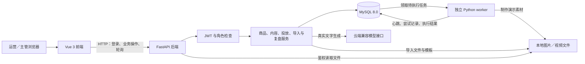
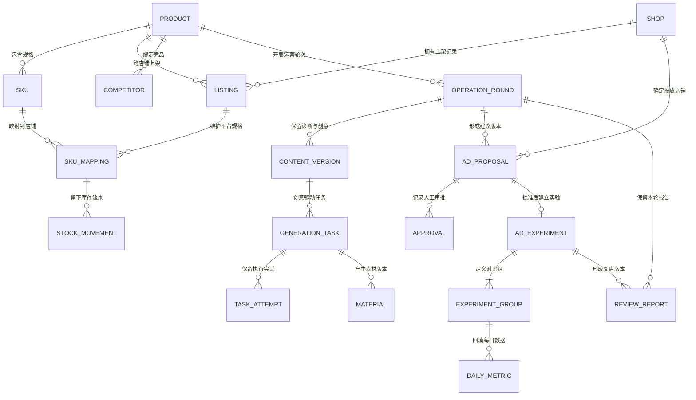
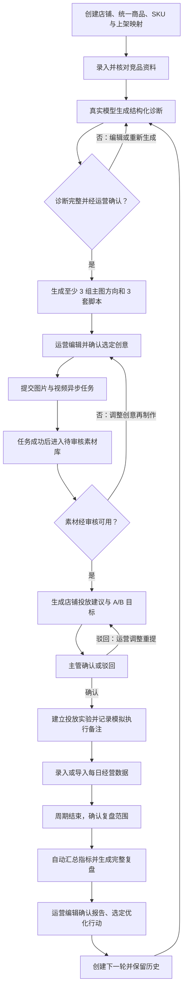
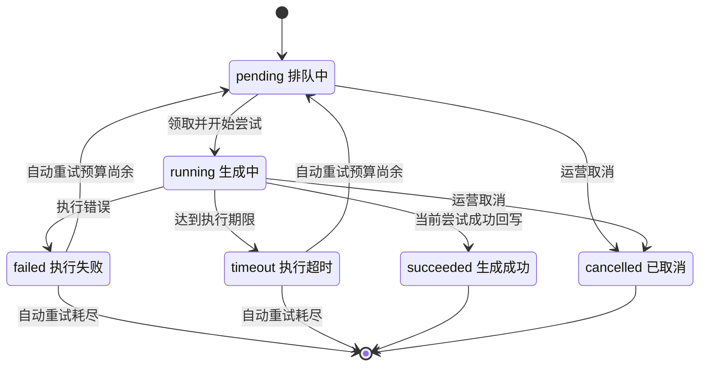
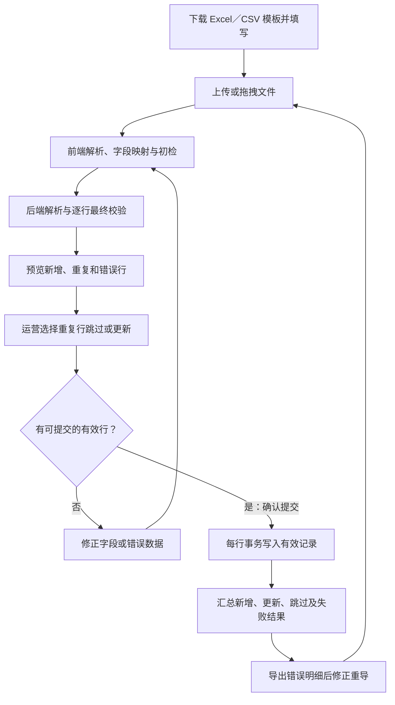
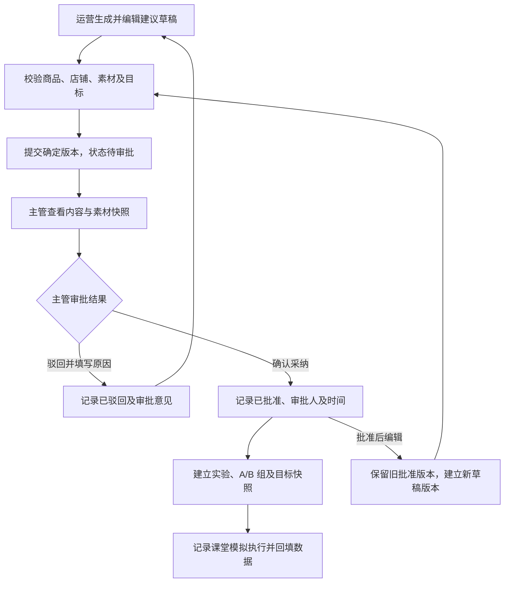

# 电商运营助手开发规格（SPEC）

版本：1.1。用途：学校教学项目开发与验收。基线日期：2026-09-28。修订：补齐既有建议内容确认／归档及前后端联调契约，业务范围不变。

本规格依据 [原始需求](Damend/Damend)、[项目执行规则](AGENTS.md)、[业务术语](Damend/CONTEXT.md) 及用户已确认的技术选择编写。当前仓库已有 `app/backend` 和 `app/frontend` 教学骨架及部分验证，仍未完成全部前后端需求。本文描述目标契约；具体实现差异及验证范围见 [开发状态](Doce/README.md)，不能将本文视为软件验收通过证据。

后端字段与详细契约见 [后端需求](Doce/后端需求文档.md)，按阶段实施、事务及实际流程图片见 [后端开发流程](Doce/后端开发流程文档.md)。以下补充均是待实现契约，不表示接口已经运行。

## 1. 目标与交付边界

### 1.1 项目目标

提供围绕单品经营的运营工作台，完整走通“建档与竞品录入 → 商品诊断 → 创意方案 → 异步素材制作与审核 → 投放建议与人工审批 → 经营数据回填 → 复盘 → 下一轮诊断”。每一阶段都有可操作页面、后端校验、持久化结果和失败反馈。

最终软件交付包含：可运行前端、Python 后端、独立任务 worker、MySQL 数据结构与迁移、演示账号、示例店铺和商品数据、Excel/CSV 模板、本地演示图片与可播放视频、配置示例、启动及完整演示说明。

### 1.2 已确认范围

| 事项 | 本项目执行口径 |
| --- | --- |
| 文字生成 | 商品诊断、主图方向、视频脚本、投放建议和复盘调用真实大模型；支持编辑、确认和归档。 |
| 图片与视频 | 素材来源采用明确标注的模拟结果；后端任务入队、调度、状态保存、失败重试、超时和取消真实实现。 |
| 店铺接入 | 模拟多平台接入，保存平台、店铺标识与脱敏授权状态；严禁保存平台明文密码或 Cookie。 |
| 竞品数据 | 手工录入、表格导入、公开商品文本解析；解析结果经运营核对。公开链接记录出处，无需真实网站抓取。 |
| 商品归属 | 一份统一商品档案关联多个店铺；店铺分别维护上架记录、规格映射、库存和经营数据。 |
| 投放审批 | 全部建议由主管／管理员确认或驳回，运营的内容确认不等于投放批准。 |
| 投放执行 | 课堂模拟并记录人工执行备注；严禁创建外部广告计划或触发真实资金扣费。 |
| 经营数据 | 按日期、店铺、商品、投放实验和实验组录入，支持每日趋势及 A/B 对比。 |
| 教学场景 | 夏季防晒衣冷启动，两个平台店铺、多规格 SKU、7 天 A/B 数据、完整复盘及下一轮诊断。 |

### 1.3 角色权限

采用预置账号，不扩展注册、找回密码和组织管理。演示角色为 `operator`（运营）与 `manager`（主管／管理员）。下表中的“查看”不授予修改权限；前端菜单和后端接口分别校验权限。

| 操作 | 运营 | 主管／管理员 |
| --- | --- | --- |
| 查看大盘、商品、内容、任务、实验及报告 | 允许 | 允许 |
| 创建商品、关联店铺、维护 SKU 和库存 | 允许 | 查看 |
| 录入竞品、生成及编辑 AI 内容、确认内容版本 | 允许 | 查看 |
| 提交任务、取消或重试任务、审核打标及归档素材 | 允许 | 查看 |
| 编辑和提交投放建议 | 允许 | 查看 |
| 确认或驳回投放建议 | 不允许 | 允许 |
| 回填／导入经营数据、确认复盘范围、进入下一轮 | 允许 | 查看 |
| 管理模拟授权、模型服务参数与队列配额 | 不允许 | 允许 |

两个角色使用不同的预置账号完成提交与审批演示；测试必须验证运营直接调用审批或配置接口时也被拒绝。

## 2. 技术栈与架构

### 2.1 技术选择

| 层次 | 选用技术 | 职责 |
| --- | --- | --- |
| 后端 | Python、FastAPI、Uvicorn、Pydantic 2 | HTTP 接口、输入输出校验、角色依赖、结构化生成校验。 |
| 数据 | MySQL 8.0、SQLAlchemy 2、PyMySQL、Alembic | 关系数据、事务、任务领取、迁移和数据库约束。 |
| 前端 | Vue 3、JavaScript、Vite、Vue Router | 四类页面、单品上下文、导航及后端接口代理。 |
| 通用界面 | Element Plus | 表单、表格、上传、弹窗和审批操作。 |
| 内容及图表 | ECharts、Quill、marked、DOMPurify | 趋势与对比图、富文本编辑、Markdown 渲染及内容净化。 |
| 表格 | SheetJS、openpyxl、Python csv | 浏览器初检，后端解析、校验、模板生成和导入。 |
| 认证 | PyJWT、pwdlib 的 Argon2 密码散列 | JWT 生成与验证、预置账号密码校验。 |
| 模型调用 | HTTPX | 调用配置的云端 Chat Completions 兼容接口。 |
| 后台任务 | 独立 Python worker、MySQL 任务表 | 调度、并发执行、心跳、超时检测和重试。 |
| 文件 | 本地文件系统 | 图片、视频、导入文件和模板；数据库记录文件归属与路径。 |
| 测试 | pytest、FastAPI TestClient／HTTPX | 业务规则、权限、接口及数据库集成验证。 |

使用 Windows 本机环境，前端、后端和 worker 分别启动，MySQL 作为数据库服务。依赖精确版本在实际实现时按兼容性锁定，不采用浮动的无约束依赖作为交付结果。本文不将未执行的安装或启动命令描述为已经验证。

### 2.2 系统架构图

任务执行不放在前端计时器或仅存于 FastAPI 内存的后台函数中。API 保存任务后及时返回任务标识；worker 独立运行并从数据库恢复排队任务。真实文字调用在业务请求中等待结果，页面显示生成中；调用期间不持有数据库行锁。

开发环境通过 Vite 代理 `/api` 请求到后端，文件也经后端鉴权接口读取。前端通过授权请求取得图片／视频文件并展示；JWT 不放在文件链接的查询参数中。

### 2.3 页面及模块

| 页面 | 功能及前端职责 |
| --- | --- |
| 运营大盘与店铺概览 | 店铺卡片、商品数、动销率、经营走势、库存预警、检索、快速录入和导入入口；由大盘与概览模块负责。 |
| 商品智能运营工作台 | 商品／轮次上下文、三块内容联动及阶段标签；工作台框架组织诊断、创意工场、投放与复盘模块。 |
| 批量导入与数据中心 | 拖拽上传、模板下载、字段映射、预览、错误行高亮及结果；由导入中心模块负责。 |
| 系统与服务配置 | 模型接口参数、模拟多模态模式、平台授权占位、并发及超时重试配置。 |

后端职责按下表划分，对应页面的完整映射见第 10 节验收对照。

| 后端模块 | 职责 |
| --- | --- |
| 商品与竞品管理 | 商品主数据、店铺上架、SKU 映射、库存流水、竞品资料和参数解析。 |
| 内容生成引擎 | 诊断、主图策略、分镜脚本的真实生成、结构化校验和版本保存。 |
| 异步任务调度引擎 | 入队、领取、执行、心跳、失败重试、超时回收和取消。 |
| 投放与复盘分析 | 投放建议、人工审批记录、每日经营数据、指标计算和复盘装配。 |
| 导入与数据校验 | Excel/CSV 解析、字段校验、重复记录处理、按行事务及结果明细。 |

## 3. 数据模型与归属

### 3.1 核心对象

以下为拟设计表及必需数据，最终字段类型和迁移以实现为准，归属、版本和唯一约束必须落实。金额采用 Decimal／MySQL DECIMAL，不用二进制浮点保存金额；业务日期按 Asia/Shanghai 的自然日记录，操作时间用 UTC 保存并按本地时区展示。

| 对象／拟表名 | 关键字段与约束 |
| --- | --- |
| 用户 `users` | 用户名唯一、密码散列、角色、启用状态。 |
| 店铺 `shops` | 店铺编码唯一、平台、名称、平台接入标识、脱敏授权状态。 |
| 商品 `products` | 商品编码唯一、名称、品类、基础属性、基础售价、主推 SKU。 |
| 商品 SKU `product_skus` | 商品标识、规格编码、颜色／尺码等属性；商品内规格编码唯一。 |
| 店铺上架 `shop_listings` | 店铺、商品、平台商品标识、在售状态；店铺与商品组合唯一。 |
| SKU 映射及库存 `sku_mappings` | 上架记录、商品 SKU、平台 SKU 标识、店铺规格售价、库存、预警阈值；同一上架记录中的 SKU 映射唯一。 |
| 库存流水 `stock_movements` | 映射标识、变更前后值、差额、原因、来源、操作人、时间。 |
| 竞品 `competitors` | 归属商品、竞品编码、平台、名称、售价、规格、卖点、公开来源、核对状态；商品内竞品编码唯一。 |
| 运营轮次 `operation_rounds` | 商品、轮次序号、当前阶段、来源报告、选定优化行动；商品内序号唯一。 |
| 内容版本 `content_versions` | 商品、轮次、内容类型（诊断／创意）、版本号、结构化内容、编辑内容、确认及归档状态、上游版本和输入快照。 |
| 生成任务 `generation_tasks` | 商品、轮次、创意版本、图片／视频类型、状态、当前尝试标识、配置快照、原任务标识。 |
| 执行尝试 `task_attempts` | 任务、尝试序号、执行身份、开始／结束时间、心跳、截止时间、错误原因；任务内序号唯一。 |
| 素材 `materials` | 商品、轮次、创意版本、任务／尝试、文件位置、类型、版本、演示来源、审核状态、标签、归档时间；同一成功尝试只创建一份对应素材记录。 |
| 投放建议版本 `ad_proposals` | 商品、轮次、店铺、内容版本、素材版本集合、策略、A/B 分组、预算、周期、目标、版本号和状态。 |
| 建议内容确认／归档字段 | 在 ad_proposals 中记录 content_confirmed_at、content_confirmed_by、archived_at；确认与审批状态分开，新版清空确认与归档字段。 |
| 审批 `approval_records` | 建议版本、确认／驳回、审批人、审批时间、意见；仅对应被审核的版本。 |
| 投放实验 `ad_experiments` | 实验编码唯一、已批准建议版本、商品、轮次、店铺、周期、目标快照、执行备注、周期结束确认；同一批准建议版本最多对应一个实验。 |
| 实验组 `experiment_groups` | 实验、A/B 组编码、素材组合、出价／预算与目标；实验内组编码唯一。 |
| 每日数据 `daily_metrics` | 日期、店铺、商品、实验、实验组、曝光、点击、订单、GMV、花费、可选详情页访问与跳失数据；上述五个归属维度组合唯一。 |
| 复盘报告 `review_reports` | 商品、轮次、店铺、实验、报告版本、数据范围和快照、目标／实际指标、五部分内容、优化行动、确认和归档状态。 |
| 导入批次及明细 `import_batches`／`import_rows` | 类型、上传文件、字段映射、行号、校验结果、冲突选择、提交结果、操作人。 |
| 服务配置 `service_configs` | 服务地址、模型名、参数、密钥的后端加密值、队列参数、更新时间和修改人。 |

JWT 签名密钥、配置加密主密钥和数据库连接凭据从后端环境配置加载。模型服务密钥只在后端解密使用，配置查询返回脱敏值；配置页支持单独更新密钥，日志和示例文件不输出真实凭据。

### 3.2 数据关系图

图展示核心归属关系；建议所选素材以关联记录保存，校验其商品一致，并在建议快照中保留素材版本。下一轮通过来源报告和商品关系追溯上一轮，不覆盖旧轮次。

### 3.3 版本与阶段规则

- 内容状态为草稿、已确认、已归档。诊断、创意和报告均可编辑、确认、归档；已被下游引用的内容保持快照，修改保存新版本并重新确认。
- 素材状态为待审核、可用、已驳回，归档另外记录。生成成功不等于审核通过；可用且未归档的素材才能被新建议选择。
- 已引用素材归档后，历史实验仍能追溯原文件和审核记录。编辑创意后重新制作得到新素材版本，旧文件不被覆盖。
- 建议版本状态为草稿、待审批、已驳回、已批准。运营独立确认内容后才能提交主管；归档另外记录，待审归档退出审批，已批归档保留旧实验。批准后编辑建立新建议版本并重新确认内容及审批；新批准版本建立新的实验记录，旧实验和经营数据保留。
- 当前阶段由本轮可用记录及前置条件确定；失败不清空前面阶段。页面提供未满足条件说明，后端拒绝跳过必要阶段或跨商品引用。

## 4. 主业务闭环

### 4.1 完整流程图

以下各流程的状态、输入、输出和异常均须体现在页面与接口中。

### 4.2 店铺、商品与库存建档

- **角色与入口**：运营进入大盘快速录入或导入中心；主管在配置页维护模拟授权状态。
- **前置条件**：运营已登录，店铺平台与接入标识可选择。
- **输入**：商品编码、名称、品类、属性、售价、规格、店铺、平台商品／SKU 标识、库存及阈值。
- **步骤**：创建店铺 → 创建统一商品 → 建立商品 SKU → 关联店铺上架 → 建立平台规格映射 → 设置库存及阈值；需要批量操作时走第 5.4 节。
- **输出与状态**：商品档案、店铺上架及映射可查询；库存维护生成流水，数量不高于阈值时产生预警。
- **异常**：重复编码、错误商品归属、无效价格或负库存提示具体字段；库存变更及流水一起提交或回滚。
- **完成证据**：同款商品在两店铺仅有一份主档案，店铺库存分别显示，预警可触发且能查看变更前后记录。

### 4.3 竞品录入与诊断

- **角色与入口**：运营进入工作台的商品档案与竞品诊断区。
- **前置条件**：商品基础属性和售价齐备，至少一份竞品资料经核对。
- **输入**：商品与 SKU／价格概况、竞品售价和规格、公开卖点、来源；下一轮可携带已选优化行动。
- **步骤**：手工录入、导入或粘贴文本解析竞品 → 核对字段 → 发起诊断 → 后端调用模型并校验结构 → 运营编辑并确认。
- **输出与状态**：诊断版本保存目标客群、价格带分析、核心卖点矩阵、转化卡点和优化方向，从草稿变为已确认。
- **异常**：竞品价格或关键属性缺失先补资料；模型调用失败、结构缺失不标为已确认，保留已有版本并允许重试。
- **完成证据**：五类诊断内容齐全，修改后重新打开仍可查看，后续创意引用确认版本。

### 4.4 创意生成

- **角色与入口**：运营进入工作台的内容创意与素材生成区。
- **前置条件**：当前商品有可引用的已确认诊断。
- **输入**：诊断版本、商品属性、目标客群、卖点、期望风格和运营补充要求。
- **步骤**：生成创意 → 校验至少 3 组主图方向和 3 套视频脚本 → 富文本编辑 → 选定制作方向／脚本并确认版本。
- **输出与状态**：每组主图含构图版式、核心文案、主打卖点、视觉呈现建议；每套脚本含开头 3 秒黄金钩子、分镜画面描述、口播台词和促单话术。
- **异常**：数量不足或结构不完整时列出问题，允许重新生成；编辑后的结构也校验，不能将缺字段的版本确认。
- **完成证据**：六份以上结构化创意可浏览与编辑，选定项保存后可提交素材任务。

### 4.5 异步素材制作与审核

- **角色与入口**：运营在创意区提交任务、查看时间线，在素材库审核。
- **前置条件**：选定创意已确认，任务所引用的商品、轮次和创意版本一致。
- **输入**：创意版本、图片／视频类型、制作选项；演示时可选择成功或故障路径。
- **步骤**：提交任务 → worker 领取并执行 → 前端轮询 → 成功文件进入素材库待审核 → 运营核验、打标、标记可用或驳回；支持归档。
- **输出与状态**：持久化任务和尝试记录、本地素材文件及审核记录；完整课堂演示包含可用图片和可用视频。
- **异常**：失败／超时重试、排队或执行中取消按第 5.3 节处理；文件缺失或视频不能播放时不判为制作成功。
- **完成证据**：任务由后台执行，刷新页面状态不丢失，素材可预览，审核与任务状态分别记录。

### 4.6 投放建议与审批

- **角色与入口**：运营生成和提交，主管／管理员在投放实验与经营复盘区审批。
- **前置条件**：商品已完成前述链路，所选素材可用且未归档，选择商品关联店铺。
- **输入**：商品定位、素材版本、人群包／定向建议、出价、预算、周期、A/B 分组和目标指标。
- **步骤**：模型生成建议 → 运营编辑 → 提交指定版本 → 主管确认或填写原因驳回 → 驳回后调整重提 → 批准后建立实验并记录课堂模拟执行备注。
- **输出与状态**：建议版本、审批记录、批准的实验与实验组；所有记录绑定单品、轮次和店铺。
- **异常**：运营越权审批返回拒绝；审批时版本已变更或素材不可用，退回重新校验，避免批准不同于所审内容的版本。
- **完成证据**：能展示一次驳回及重新批准，记录审批人和时间，系统不操作外部广告账户。

### 4.7 经营数据回填

- **角色与入口**：运营在工作台表单或导入中心录入。
- **前置条件**：实验已批准，实验组已定义。
- **输入**：每日曝光、点击、订单、GMV、广告花费，以及可选详情页访问／跳失；归属维度和日期必须一致。
- **步骤**：录入或导入 → 后端校验 → 保存原始数据 → 计算每日和汇总指标 → 周期结束后确认复盘数据范围。
- **输出与状态**：每日经营记录、走势图和 A/B 对比；范围确认后自动触发真实文字复盘生成。
- **异常**：重复记录先选择跳过或更新；周期外日期和归属错误不入库；分母为零仍保存原始值，派生指标显示不可计算。
- **完成证据**：手工与导入均可用，重导不重复累加，回填不自动扣减库存。

### 4.8 复盘与下一轮

- **角色与入口**：运营在工作台查看报告、编辑确认并选择优化行动。
- **前置条件**：实验周期结束且复盘范围已确认，有有效经营数据；报告记录缺失日期或字段。
- **输入**：商品／诊断／创意／素材快照、实验审批及执行记录、目标、实际汇总和经营数据快照。
- **步骤**：程序确定性计算指标 → 真实模型形成分析 → 校验五部分报告 → 保存并显示 → 运营编辑确认 → 选定行动一键建立下一轮诊断。
- **输出与状态**：可编辑、确认、归档的版本报告；下一轮关联来源报告和行动，历史轮次保持可追溯。
- **异常**：调用失败保留原始数据和旧报告，显示原因并允许重试；数据修改后生成新报告版本，旧报告仍对应原快照。
- **完成证据**：报告包含第 7.3 节五部分，事实、归因推测和行动分别表达，下一轮带入所选优化事项。

## 5. 专项处理规则与流程图

### 5.1 登录与权限

预置两个演示账号，密码保存为散列。登录成功返回 JWT 与当前用户信息；教学默认有效期 8 小时。前端保存本次会话凭据，请求携带 Bearer token；退出登录清除前端凭据，过期后重新登录。接口验证签名、有效期、用户启用状态及数据库中的当前角色。

工作台数据访问依次检查用户身份、角色、商品归属及操作前置条件。界面隐藏按钮不能替代接口授权。演示项目中的两个角色查看同一团队的店铺数据，不扩展多租户权限体系。

### 5.2 真实模型调用与可编辑内容

模型配置包含服务地址、模型名、密钥、温度和请求超时。后端通过 HTTPX 调用兼容接口；默认文字请求超时 60 秒。诊断、创意和投放建议按要求的结构生成，再用 Pydantic 校验；复盘由程序提供已计算指标和证据，模型输出分析及行动。

请求先取得输入快照，外部调用期间不占用业务事务；返回后再次检查上游版本，再保存生成版本。上游被修改时提示重新确认，避免把旧输入结果无提示地接入新的流程。网络异常、服务拒绝或结构错误返回清楚的业务反馈，保留原内容，由运营重试；不会静默以模拟文字替代真实调用。

Quill 编辑保存结构化字段及对应编辑内容；Markdown 报告经内容净化后预览。指标表中的数值由原始数据计算，修改经营数据再重新生成报告；运营可以直接修改 AI 分析文字，不把手改叙述作为新的统计事实。

### 5.3 任务状态与调度

| 参数 | 默认值及含义 |
| --- | --- |
| 前端轮询 | 2 秒；终态停止轮询，页面重开查询持久化状态。 |
| 全局并发配额 | 2；管理员调整后影响后续调度，已运行任务不因调小配额被主动取消。 |
| 单次执行期限 | 60 秒，从进入 running 计时；排队时间单独展示。 |
| 自动重试 | 最多 2 次，连同首次执行最多 3 次尝试。 |
| worker 调度检查 | 默认每 1 秒检查待执行任务及执行期限。 |
| 心跳 | 默认每 10 秒更新执行存活时间；worker 重启后检查截止时间及失联尝试。 |

调度步骤：

1. API 校验创意版本后写入 pending 任务，保存超时／重试等配置快照并返回任务标识。
2. 单个独立 worker 调度器运行于本机，以可终止的子进程执行素材制作，默认最多同时执行两项。
3. 短事务内锁定全局配额控制记录（队列配置单例），核对运行名额，再用 MySQL 行锁领取 pending 任务，建立新的尝试身份并提交；执行素材制作时不持有数据库锁。
4. worker 记录心跳并检查期限。成功回写必须同时满足任务为 running、尝试身份与当前一致、未被取消且未过期；文件和素材记录按当前尝试关联，重复回写不重复建素材。
5. 失败或超时保存本次尝试原因，有剩余自动预算则重新入队并建立下一次尝试，时间线保留失败历史。预算耗尽后保持 failed／timeout，允许运营人工重试创建关联原任务的新任务。
6. 取消 pending／running 任务后记录 cancelled，停止后续重试并终止能够终止的执行，释放逻辑名额。迟到文件不进入素材库，不覆盖 cancelled 或下一次尝试的状态。
7. worker 重启后继续领取 pending；已过期或失联超过执行期限的 running 尝试回收为 timeout，再按预算处理。取消任务不会因重启复活。

演示模式通过同一队列触发：正常返回示例文件、首次失败后重试成功、持续失败耗尽预算、执行超过期限、排队取消、运行中取消及迟到结果。所有图片和视频展示“演示素材”标识，视频必须实际可播放。

### 5.4 导入流程

后端使用上传原文件和确认的字段映射重新校验，不信任浏览器传回的“校验通过”标记。预览不修改业务数据；提交时再次检查归属与重复情况。每个有效行的关联写入采用一个事务，库存变更与流水必须一起成功；无效行不提交，其他有效行不受影响。

文件内相同业务键出现多行时，将该键的相关行全部标为重复组，要求运营选定保留一行后再提交，不按不明确的文件顺序自动覆盖。与数据库重复的记录由运营选择跳过或更新。更新保存前后值及来源；重导不能导致订单、金额或库存重复累计。

### 5.5 审批流程

主管审批针对提交时的版本；待审批版本不原地修改，运营调整后重新确认内容并提交。建议归档与审批竞争同版本行锁，待审归档后主管不可批准；批准后归档不取消既有实验。审批与实验建立采用同一事务，同一建议版本不重复建立实验。确认／驳回均保留审批人、时间与意见，驳回原因必填。

### 5.6 配置维护

主管／管理员维护云端文字服务参数、模型名、模拟图片／视频服务参数、平台授权占位及队列规则。参数校验通过后保存并记录修改人、时间，普通运营不可调用写配置接口。

任务保存提交时的超时和重试配置，后续修改不改变正在运行尝试的截止时间。并发属于全局调度限制，使用当前配置，提交时配额值保留作为追溯信息。配置页明确多模态运行于模拟模式；真实生图／生视频接入不属于本教学版本的验收范围。

## 6. 拟设计接口与契约

### 6.1 通用约定

API 前缀 `/api`；除登录外按 JWT 鉴权，普通业务读取接口允许两个角色，配置接口的读取与写入均仅允许主管，其他写操作按第 1.3 节。下列路径是开发契约，尚无已运行接口。请求字段由 Pydantic 定义，所有内容引用同时校验商品、轮次及版本归属。

普通请求使用 JSON，文件上传使用 multipart。创建返回 201，任务受理返回 202；身份无效 401、权限不足 403、资源不存在 404、版本或状态冲突 409、字段错误 422、外部模型服务失败 502／超时 504。错误响应给出错误代码、可读说明和字段／行号明细，保留用户未提交内容以便修正。

资源列表支持页码、页大小及必要的商品／店铺／日期筛选。任务查询返回当前状态、每次尝试、时间和错误原因；所有内容响应携带归属与版本。金额按十进制口径传递和校验，前端仅作展示与录入。

### 6.2 业务接口

| 路径与方法 | 输入／输出与职责 | 写操作角色／前置条件 |
| --- | --- | --- |
| `POST /auth/login`；`GET /auth/me` | 账号密码换取 token；查询当前用户与角色。 | 登录校验启用状态和密码；me 需登录。 |
| `GET /dashboard` | 日期、店铺筛选；返回商品数、动销率、预警及经营走势。 | 两角色读取，聚合口径见第 7 节。 |
| `GET/POST /shops`；`PATCH /shops/{id}` | 店铺基础资料及关联平台标识。 | 运营维护基础档案；授权状态由配置接口维护。 |
| `GET/POST /products`；`GET/PATCH /products/{id}` | 商品基础档案、检索、主推规格及详情。 | 运营；编码唯一。 |
| `GET/POST /products/{id}/skus`；`PATCH /skus/{id}` | 商品 SKU 的规格与基础信息。 | 运营；SKU 属于指定商品。 |
| `GET/POST /products/{id}/listings`；`PATCH /listings/{id}` | 关联店铺、平台商品标识、售价与在售状态。 | 运营；商品与店铺存在，组合唯一。 |
| `GET/POST /listings/{id}/sku-mappings`；`PATCH /sku-mappings/{id}` | 平台 SKU 映射、店铺售价与阈值。 | 运营；规格属于上架商品，更新库存走独立调整接口。 |
| `POST /sku-mappings/{id}/stock-adjustments`；`GET /sku-mappings/{id}/stock-movements` | 目标库存、原因；返回库存与流水。 | 调整由运营提交，库存及流水同事务。 |
| `GET/POST /products/{id}/competitors`；`POST /products/{id}/competitors/parse`；`PATCH /competitors/{id}` | 手工资料或公开文本；返回结构化待核对资料。 | 运营；解析不能代替人工核对。 |
| `GET/POST /products/{id}/rounds` | 查看轮次或建立首轮；返回阶段及来源。 | 创建由运营提交，同商品编号唯一。 |
| `POST /rounds/{id}/diagnoses/generate`；`POST /rounds/{id}/creatives/generate` | 输入快照及补充要求；返回结构化内容版本。 | 运营；前置条件见第 4 节。 |
| `GET/PATCH /contents/{id}`；`POST /contents/{id}/confirm`；`POST /contents/{id}/archive` | 查看、编辑为新版本、确认或归档诊断／创意。 | 写操作由运营提交；已引用版本保留。 |
| `GET/POST /tasks`；`GET /tasks/{id}`；`POST /tasks/{id}/cancel`；`POST /tasks/{id}/retry` | 创意版本、类型；返回状态与尝试。 | 运营提交／取消／重试；取消仅 pending 或 running，人工重试仅最终 failed 或 timeout。 |
| `GET /materials`；`GET /materials/{id}/file`；`POST /materials/{id}/review`；`PATCH /materials/{id}/tags`；`POST /materials/{id}/archive` | 列表、文件、审核意见、标签、归档。 | 运营写操作；文件读取需登录，归档不移除历史引用。 |
| `POST /rounds/{id}/ad-proposals/generate`；`GET/PATCH /ad-proposals/{id}`；`POST /ad-proposals/{id}/submit` | 店铺、素材、周期、策略及目标；返回建议版本。 | 运营生成／编辑／提交；可用素材及阶段校验。 |
| `POST /ad-proposals/{id}/confirm`；`POST /ad-proposals/{id}/archive` | 运营确认指定草稿文字或归档指定版本，输入 expected_version，成功 200。 | 运营；确认不改审批状态，提交须已内容确认；归档待审停止审批，历史实验保留。 |
| `POST /ad-proposals/{id}/confirm`；`POST /ad-proposals/{id}/archive` | expected_version；确认运营内容或归档指定建议版本。 | 仅运营；确认不改变审批 status；提交须已确认内容，归档待审退出审批，历史实验保留。 |
| `POST /ad-proposals/{id}/approve`；`POST /ad-proposals/{id}/reject` | 审批意见；返回审批记录和批准实验。 | 仅主管；待审批版本，驳回原因必填。 |
| `GET /experiments/{id}`；`PATCH /experiments/{id}/execution-note` | 实验、目标及执行备注。 | 运营修改备注；实验已经批准。 |
| `GET/POST /experiments/{id}/metrics`；`PATCH /metrics/{id}` | 每日经营原始数值；返回记录及派生指标。 | 运营写操作；日期、归属、唯一键校验。 |
| `POST /experiments/{id}/close-period`；`POST /experiments/{id}/reviews/generate` | 确认数据范围并自动触发复盘；失败后可重试生成。 | 运营；周期结束、有有效数据，成功报告保存快照。 |
| `GET/PATCH /reviews/{id}`；`POST /reviews/{id}/confirm`；`POST /reviews/{id}/archive`；`POST /reviews/{id}/next-round` | 报告、编辑内容或所选行动；返回报告版本或新轮次。 | 运营写操作；next-round 需确认报告及有效行动。 |
| `GET /imports/templates/{type}`；`POST /imports/preview`；`POST /imports/{id}/commit`；`GET /imports/{id}` | 模板、文件和字段映射、冲突选择；返回逐行校验和导入结果。 | 两角色下载／查看，运营预览与提交，提交前重校验。 |
| `GET/PATCH /settings/services`；`GET/PATCH /settings/queue`；`PATCH /settings/shops/{id}/authorization` | 脱敏模型配置、配额参数和授权占位。 | 仅主管读取或写入配置；普通用户无配置管理权限。 |

重复点击提交通过前端提交中状态与后端业务唯一约束防止重复审批、建实验和重复数据入库。生成新版本是显式操作，不能把刷新页面当作自动重新生成。

### 6.3 已补齐的读取与导入契约

| 能力 | 拟实现约定 |
| --- | --- |
| 工作台恢复 | 商品详情及轮次列表返回 resource_index：contents、ad_proposals、experiments、reviews 索引；包含资源 ID、归属、版本／状态及归档信息，建议另含 is_current 和 content_confirmed。 |
| 任务终态与轮询 | 任务列表／详情返回 terminal、retry_available、attempts、config_snapshot、original_task_id 和当前有效 poll_interval_seconds；取消时间及原因可追溯，运营不读取完整配置。 |
| 工作表及明细 | Excel preview 接收 sheet_name? 并保存／回显，省略取首表，CSV 为 null；commit 读取相同表。批次查询 rows 为 items/total/page/page_size，summary 为整批，支持逐页导出全部错误。 |
| 导入防重提交 | 批次 previewed→committing→committed；committing 内部防重占用，异常保留已提交行结果，未处理行通过新批次修正，不自动重放。 |
| 实施入口 | 同步 SQLAlchemy／PyMySQL、普通 def 路由、同步 HTTPX，局部 Session；模型密钥采用 cryptography.Fernet，主密钥从环境读取。 |

### 6.3 前后端联调补充契约

依据 [后端开发流程第 10 节](Doce/后端开发流程文档.md)，落实既有功能的读取及动作约定。上述方法展开后共 72 个；仍为拟实现契约，没有运行验证。

| 能力 | 对接约定 |
| --- | --- |
| 建议运营确认／归档 | 两动作输入 expected_version，200 返回建议。建议增加 content_confirmed_at、content_confirmed_by、archived_at；content_confirmed 由确认时间推导。submit 仅允许未归档、当前、已内容确认的 draft。 |
| 刷新与历史恢复 | 商品详情 rounds 摘要及轮次列表的各项返回 resource_index，包含 contents、ad_proposals、experiments、reviews 数组；各项含 ID、归属及适用的 kind、version、status、shop_id、archived_at。建议项另含 proposal_key、content_confirmed、is_current；最新版本按 proposal_key 判定。 |
| 任务读取 | 列表及详情返回 terminal、retry_available、attempts、config_snapshot、original_task_id、poll_interval_seconds、material_id、cancelled_at、cancel_reason。尝试 queued_at 从首次提交或上次尝试结束推导；排队不计入执行期限。运营只读任务提供的轮询值，不读完整配置。 |
| 工作表 | preview multipart 支持 sheet_name；xlsx 省略则选首表并回显，CSV 为 null；批次保存所选工作表，commit 重新读取同表。field_mapping 键为原表头，值为规范字段名。 |
| 导入明细 | GET /imports/{id} 返回 rows 的 items/total/page/page_size，summary 覆盖整批。提交内部占用状态 committing 可查询，完成后 committed；结果未知时查询，不重放 commit。 |
| 历史快照 | 内容、建议、素材、实验和报告返回适用的上游版本、引用与快照；历史不由当前资料替代。 |

详情、字段类型和恢复路径见 [后端需求](Doce/后端需求文档.md)及 [前端开发流程](Doce/前端开发流程文档.md)。生产构建与部署不改变本项目已确认的教学、模拟授权及人工投放边界。

## 7. 模板、指标与报告

### 7.1 导入模板

提供 `.xlsx` 和 UTF-8 CSV，表头支持映射为下列字段。模板文件是未来软件交付物，本文先规定字段与校验。

| 类型 | 必填字段 | 可选字段及处理 |
| --- | --- | --- |
| 商品信息 | `product_code`、`name`、`category`、`base_price` | 商品属性、主推规格；编码重复时选择跳过或更新。店铺关联与规格可在工作台补齐后进入后续阶段。 |
| SKU 库存 | `shop_code`、`product_code`、`sku_code`、`stock_quantity` | `warning_threshold`；要求已有上架及 SKU 映射，数量采用目标库存值，更新产生差额流水。 |
| 竞品资料 | `product_code`、`competitor_code`、`name`、`price` | 平台、规格、卖点、公开 URL／文本；导入为待核对，运营核对后才能参与诊断。 |
| 经营数据 | `date`、`shop_code`、`product_code`、`experiment_code`、`group_code`、`impressions`、`clicks`、`orders`、`gmv`、`ad_spend` | `detail_visits`、`detail_bounces`；补充字段成对填写，缺少时跳失率不可判断。 |

日期采用 `YYYY-MM-DD`，金额统一人民币元，计数为非负整数，库存阈值为非负整数。商品售价为正数；GMV 和花费可为零。后端检查外键归属、实验批准状态、周期日期及唯一范围；详情页跳失次数不超过访问次数。经营模板不直接导入 CTR、转化率和 ROI，统一由原始数值计算。

### 7.2 指标口径

| 指标 | 公式与展示 |
| --- | --- |
| CTR | 点击数 ÷ 曝光数，百分比。 |
| 转化率 | 订单数 ÷ 点击数，百分比。 |
| ROI | GMV ÷ 广告花费，倍数；页面注明本项目的广告投入产出比口径。 |
| 详情页跳失率 | 详情页跳失次数 ÷ 详情页访问次数，百分比。 |
| 在售动销率 | 所选期间有订单的在售商品数 ÷ 该范围在售商品总数，按商品去重。 |
| 在售价格带 | 所选商品在售店铺 SKU 售价的最小值至最大值。 |

分母为零返回不可计算，不用零或无限大代替。缺失不等于零；选定范围只有部分记录具备详情页字段时，显示数据缺失及可计算子范围，不将子范围结果标为完整周期结果。跨日期、组别、店铺先求原始值之和，再计算比率；百分比和 ROI 默认展示两位小数，比较及汇总使用未舍入值。

大盘默认近 7 天并允许指定日期；全局商品数按统一档案去重，各店铺按关联商品统计。全局动销率先限定在售范围，再按商品去重检查是否有订单。库存预警以店铺 SKU 库存不高于配置阈值判断。

### 7.3 复盘报告固定结构

1. **单品全景信息**：名称、品类、在售价格带、主推 SKU、对标竞品概要。
2. **智能诊断总结**：目标客群、核心卖点矩阵、转化卡点、价格竞争力评估。
3. **视觉与内容资产**：采纳主图方向、选定分镜脚本、关联优质素材及版本。
4. **投放实验记录**：建议策略、A/B 配置、审批人、审批时间、审批意见与执行备注。
5. **经营复盘与后评价**：目标对比实际、流量／转化分析、证据与归因推测、后续优化行动。

报告明确日期范围、店铺、商品、实验和数据版本。没有详情页数据时不能写“已验证跳失偏高”；模型可提出待验证原因，并说明需要补充的证据。下一轮诊断接收选中的行动及来源，不直接执行改价、备货或真实投放。

## 8. 教学示例与演示步骤

### 8.1 示例准备

- 两个平台店铺 `SHOP-A`、`SHOP-B`，模拟授权已配置。
- 一份商品 `SUN-001`：夏季凉感防晒衣，示例售价 299 元；蓝色／灰色、S／M 构成 4 个 SKU，在两店铺分别映射库存，其中至少一项库存低于阈值。
- 两份明确标注为合成教学数据的竞品资料，包含售价、规格、防晒／透气卖点和资料来源说明。
- 两个预置角色账号、可用的真实文字模型配置、本地演示图片与短视频文件。
- 本轮实验在 `SHOP-A` 进行，A 组与 B 组保持人群、售价和周期一致，以不同主图方向作为主要对比变量；另一个店铺用于验证映射、库存及大盘归属。

### 8.2 七天经营样例

以下均为合成数据；日期可选用 2026-09-21 至 2026-09-27，演示时把大盘过滤范围改为该周期。表中 D1—D7 表示连续七天，各行花费为 300 元，GMV 由示例订单数乘以 299 元得到。

| 日 | 组 | 曝光 | 点击 | 订单 | GMV | 花费 | 详情访问 | 详情跳失 |
| --- | --- | --- | --- | --- | --- | --- | --- | --- |
| D1 | A | 8000 | 160 | 3 | 897 | 300 | 144 | 100 |
| D1 | B | 8000 | 240 | 4 | 1196 | 300 | 216 | 173 |
| D2 | A | 9000 | 180 | 4 | 1196 | 300 | 162 | 113 |
| D2 | B | 9000 | 270 | 4 | 1196 | 300 | 243 | 194 |
| D3 | A | 10000 | 200 | 4 | 1196 | 300 | 180 | 126 |
| D3 | B | 10000 | 300 | 5 | 1495 | 300 | 270 | 216 |
| D4 | A | 11000 | 220 | 5 | 1495 | 300 | 198 | 139 |
| D4 | B | 11000 | 330 | 6 | 1794 | 300 | 297 | 238 |
| D5 | A | 12000 | 240 | 4 | 1196 | 300 | 216 | 152 |
| D5 | B | 12000 | 360 | 6 | 1794 | 300 | 324 | 259 |
| D6 | A | 10000 | 200 | 4 | 1196 | 300 | 180 | 126 |
| D6 | B | 10000 | 300 | 5 | 1495 | 300 | 270 | 216 |
| D7 | A | 10000 | 200 | 4 | 1196 | 300 | 180 | 126 |
| D7 | B | 10000 | 300 | 5 | 1495 | 300 | 270 | 216 |

实验预设目标：整体 CTR 至少 2.20%，转化率至少 3.00%，ROI 至少 5.00 倍，详情页跳失率不高于 40.00%。整体实际曝光 140000、点击 3500、订单 63、GMV 18837 元、花费 4200 元、详情访问 3150、跳失 2394；CTR 2.50%，转化率 1.80%，ROI 4.49 倍，跳失率 76.00%。

A 组 CTR 2.00%、ROI 3.99 倍；B 组 CTR 3.00%、ROI 4.98 倍。报告能据此说明整体 CTR 超过目标、转化和 ROI 未达标、详情页跳失偏高；“面料说明不足导致跳失”只能作为待验证归因，优化行动可选择下一轮补充面料特写说明。

### 8.3 演示顺序

1. 登录主管，配置模拟店铺授权、真实文字模型、默认队列参数；切换运营登录。
2. 创建两店铺关联和统一防晒衣档案，维护规格、映射、库存，演示预警及库存流水。
3. 录入并解析竞品，核对后生成诊断，修改一处内容并确认。
4. 生成至少 3 组主图和 3 套脚本，编辑选定项；为 A/B 组制作不同主图，并制作至少一个视频。
5. 查看任务时间线，审核图片与视频为可用，打标并归档一个额外素材版本；分别演示失败重试、超时和取消。
6. 生成 A/B 投放建议并提交；主管驳回，运营修改后重提，主管批准，填写课堂模拟执行备注。
7. 手工录入 D1 两组数据，导入 D2—D7；重导重复行选择跳过，加入一行负花费错误数据验证错误明细，再修正重导。
8. 结束周期并确认范围，自动生成五部分复盘；核对第 8.2 节指标，编辑分析并确认。
9. 选定面料特写优化行动进入第二轮诊断，验证第一轮仍可查看。

七天使用历史合成数据演示，无需现实等待七天。真实模型生成文案不要求逐字等于示例，验收检查结构、证据和流程。

## 9. 开发顺序与运行组织

### 9.1 分阶段实现

| 阶段 | 内容 | 阶段完成条件 |
| --- | --- | --- |
| P1 | 项目结构、配置、MySQL 迁移、预置账号、JWT、基础页面与路由。 | 两角色能登录，接口拒绝越权，前后端请求连通。 |
| P2 | 店铺、商品、SKU、上架映射、库存流水、预警与竞品。 | 同款跨店铺归属正确，可录入核对竞品，库存变更可追溯。 |
| P3 | 真实模型适配、诊断与创意结构、编辑、确认和版本。 | 五类诊断字段、3 组主图及 3 套脚本达标，编辑可保存。 |
| P4 | MySQL 队列、worker、尝试身份、心跳、重试、超时、取消及素材库。 | 图片与视频可预览，全部六种任务状态及迟到结果处理可验证。 |
| P5 | 投放建议、A/B 目标、审批、实验及执行备注。 | 完成驳回／重提／确认，批准内容保留快照且不重复建立实验。 |
| P6 | 模板、字段映射、导入事务、每日指标、大盘、复盘及下一轮。 | 样例指标正确，报告五部分齐全，下一轮保留来源与历史。 |
| P7 | 页面联调、示例数据、测试、配置和演示说明。 | 第 10 节逐项取得实际证据，完成端到端演示。 |

### 9.2 拟组织方式

后端按路由、Pydantic 契约、数据模型、业务服务和 worker 分层；数据库事务与角色检查在后端完成。前端按四类页面及五项模块职责组织，工作台统一持有当前商品与轮次上下文。演示资源与实际生成记录分开存放，以版本和尝试身份命名文件，避免覆盖。

首次运行准备流程：创建项目数据库与环境配置 → 执行迁移 → 初始化账号及示例资源 → 启动 FastAPI → 启动独立 worker → 启动 Vue 前端 → 登录并验证模型配置 → 按第 8 节演示。实际命令、配置示例和锁定依赖在实现并验证后写入启动说明。

## 10. 验收与验证

### 10.1 原需求八项验收对照

下表是未来软件的验收计划，不代表当前已通过。实施时逐项记录操作、实际结果、截图／日志／数据库证据与未通过原因。

| 编号 | 原需求验收项 | 规格定位与执行证据 |
| --- | --- | --- |
| A1 | 店铺创建、单品建档、多规格 SKU 库存维护。 | 第 3、4.2 节；两店铺、一主档案、四规格、库存预警和流水查询。 |
| A2 | 竞品录入及结构化诊断。 | 第 4.3、5.2 节；竞品核对、真实调用记录、五类字段与确认版本。 |
| A3 | 至少 3 组主图与 3 套视频脚本，支持在线修改。 | 第 4.4 节；数量及必填结构检查、编辑后重新读取保存内容。 |
| A4 | 图片和视频异步任务、状态、失败重试及取消。 | 第 5.3 节；两类任务、尝试时间线、超时及取消后迟到结果不入库。 |
| A5 | 素材审核、打标和归档。 | 第 4.5、3.3 节；素材可预览、审核记录、标签和归档后选择规则。 |
| A6 | 投放建议人工确认或驳回记录。 | 第 4.6、5.5 节；主管驳回／重提／批准、身份时间及版本快照。 |
| A7 | 经营数据录入或导入及自动复盘。 | 第 4.7、4.8、7 节；手工与导入结果、正确指标和五部分可编辑报告。 |
| A8 | 至少一个单品完整闭环演示。 | 第 8 节；第一轮全链路证据与第二轮来源报告、行动及诊断记录。 |

### 10.2 页面、模块与报告覆盖

| 需求类别 | 覆盖位置与检查内容 |
| --- | --- |
| 多店铺建档、SKU、预警、竞品对标 | 大盘及档案区；第 3、4.2、4.3、7.2 节。 |
| 客群、卖点、价格与转化诊断 | 内容生成引擎和诊断看板；第 4.3 节五类结构。 |
| 主图、脚本、异步素材与版本 | 创意工场及调度引擎；第 4.4、4.5、5.3 节。 |
| 人群包、出价、A/B 与人工审批 | 投放与复盘模块；第 4.6、5.5 节。 |
| GMV、曝光、CTR、转化率、ROI 与复盘 | 经营表单、差异图表、大盘及报告；第 4.7、4.8、7 节。 |
| 导入中心与数据校验引擎 | 拖拽、字段映射、客户端初检、错误行高亮、后端逐行事务；第 5.4、7.1 节。 |
| 系统与服务配置 | 接口参数、脱敏授权、任务参数；第 5.6 节及主管权限测试。 |
| 报告五部分格式与迭代 | 第 7.3 节；版本快照、可编辑预览、下一轮诊断来源。 |

### 10.3 必须验证的异常

| 场景 | 预期结果 |
| --- | --- |
| 运营直接调用主管审批或配置接口 | 返回 403，不写审批或配置记录。 |
| 创意引用其他商品或未确认诊断 | 明确拒绝，原内容保留。 |
| 模型失败、输出字段缺失或数量不足 | 显示原因及重试入口，不确认不完整版本。 |
| 并发重复领取、重复成功回写 | 不突破配额、不重复执行同一尝试、不重复建素材。 |
| 首次任务失败、持续失败或执行超时 | 保留尝试历史，按预算重试，耗尽后保留失败／超时。 |
| pending／running 取消及迟到回写 | 取消保持终态，后续结果不进入素材库。 |
| worker 重启 | pending 可继续，过期 running 回收，cancelled 不复活。 |
| 已批准建议编辑或重复审批 | 新版本重新审批，旧记录保持；不重复建立实验。 |
| 经营数据归属错误、日期超出周期或负数 | 逐字段／逐行拒绝，无错误实绩入库。 |
| 导入含有效行、错误行、重复行或事务失败 | 有效行独立提交，失败行不留半条记录，重导不累加。 |
| 曝光、点击或花费为零 | 原始数据可保存，相关比率不可计算。 |
| 汇总、缺失详情页数据、数据后续更新 | 按原始和计算；缺失标注无法判断；旧报告保留原快照，新结果生成新版本。 |
| 页面切换商品或轮次 | 诊断、任务、素材、实验及报告一起切换，不残留其他商品数据。 |

数据库锁、按行事务和唯一约束的集成验证使用 MySQL，不用 SQLite 的行为代替 MySQL 结果。真实文字服务验证与模拟素材故障验证分别记录。文档检查只验证需求覆盖、图表、链接和示例计算，不能据此标记软件功能通过。

## 11. 技术参考

以下官方资料用于实现时核对技术用法；业务口径仍以本文及已确认项目规则为准。

- [FastAPI：SQL 数据库](https://fastapi.tiangolo.com/tutorial/sql-databases/)、[JWT 与密码散列](https://fastapi.tiangolo.com/tutorial/security/oauth2-jwt/)、[后台任务边界](https://fastapi.tiangolo.com/tutorial/background-tasks/)。
- [SQLAlchemy：MySQL 与 PyMySQL](https://docs.sqlalchemy.org/en/20/dialects/mysql.html)、[事务管理](https://docs.sqlalchemy.org/en/20/orm/session_transaction.html)。
- [MySQL 8.0：锁定读取](https://dev.mysql.com/doc/refman/8.0/en/innodb-locking-reads.html)。
- [Vue 3 入门](https://vuejs.org/guide/quick-start)、[Element Plus](https://element-plus.org/en-US/guide/quickstart.html)、[ECharts](https://echarts.apache.org/handbook/en/get-started/)、[Quill](https://quilljs.com/docs/quickstart)。
- [SheetJS](https://docs.sheetjs.com/docs/)、[openpyxl](https://openpyxl.readthedocs.io/en/stable/)。
- [Mermaid 流程图](https://mermaid.js.org/syntax/flowchart.html)、[状态图](https://mermaid.js.org/syntax/stateDiagram.html)、[实体关系图](https://mermaid.js.org/syntax/entityRelationshipDiagram.html)。
